# 🛡️ AegisShield EDR & Network AdBlocker Suite

> **Enterprise-Grade Real-Time Endpoint Detection and Response (EDR), Remote Desktop / LOLRMM Hunter, Process Threat Eradicator, System-Wide Network Ad Blocker, Web Traffic Inspector, and Origin Tracer for Windows.**

[](https://python.org)
[](https://microsoft.com)
[](LICENSE)
[-brightgreen.svg)](tools/test_engine.py)
[](http://127.0.0.1:8888)
[](http://127.0.0.1:8080)

---

## 📸 System Screenshots

| View 01: Active Threats & Eradication | View 02: Network Radar & IP Origin Tracer |
| :---: | :---: |
| 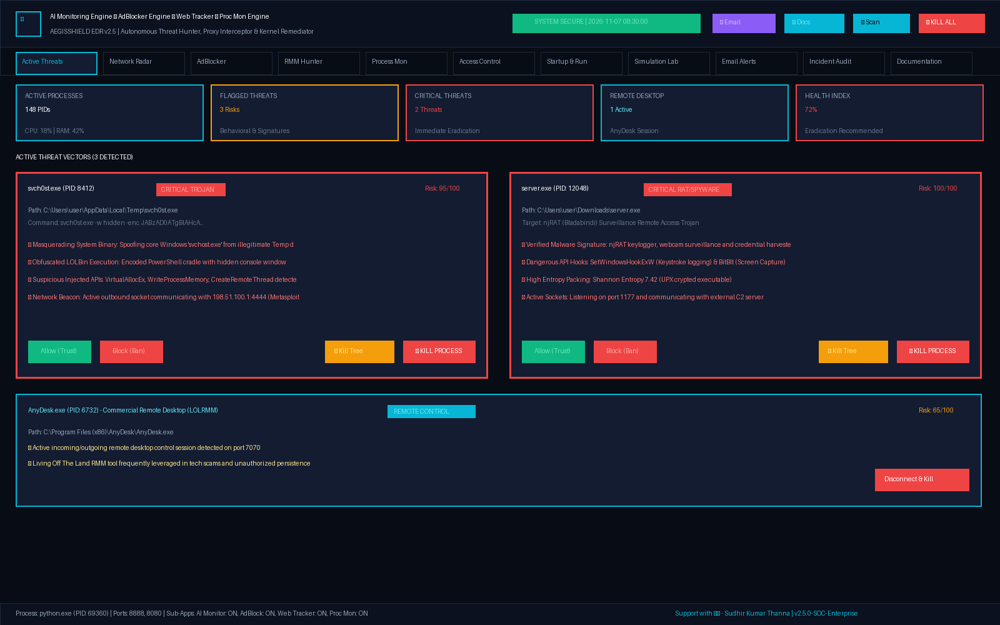 | 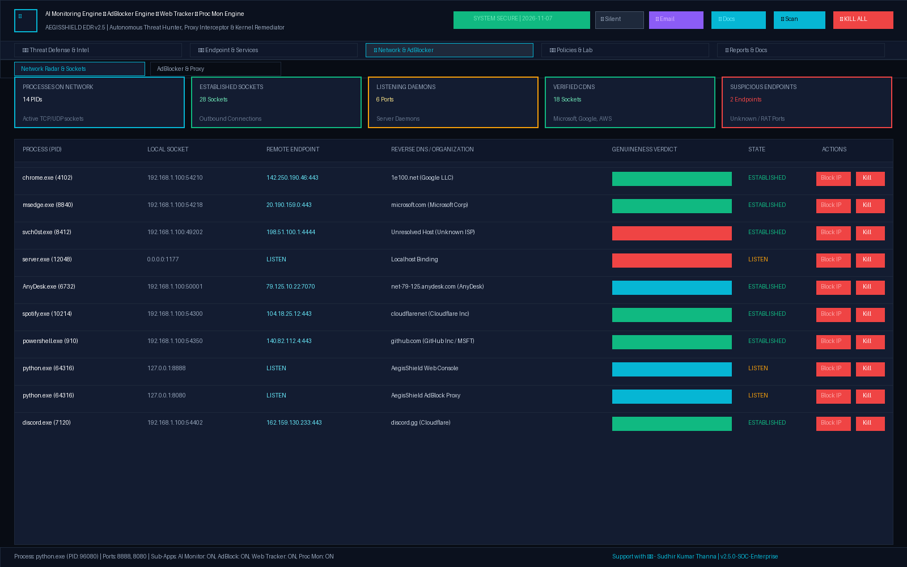 |

| View 03: System AdBlocker & Web Analytics | View 04: Remote Desktop & LOLRMM Hunter |
| :---: | :---: |
| 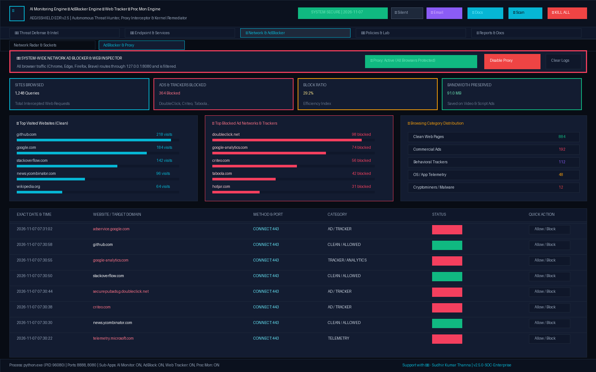 | 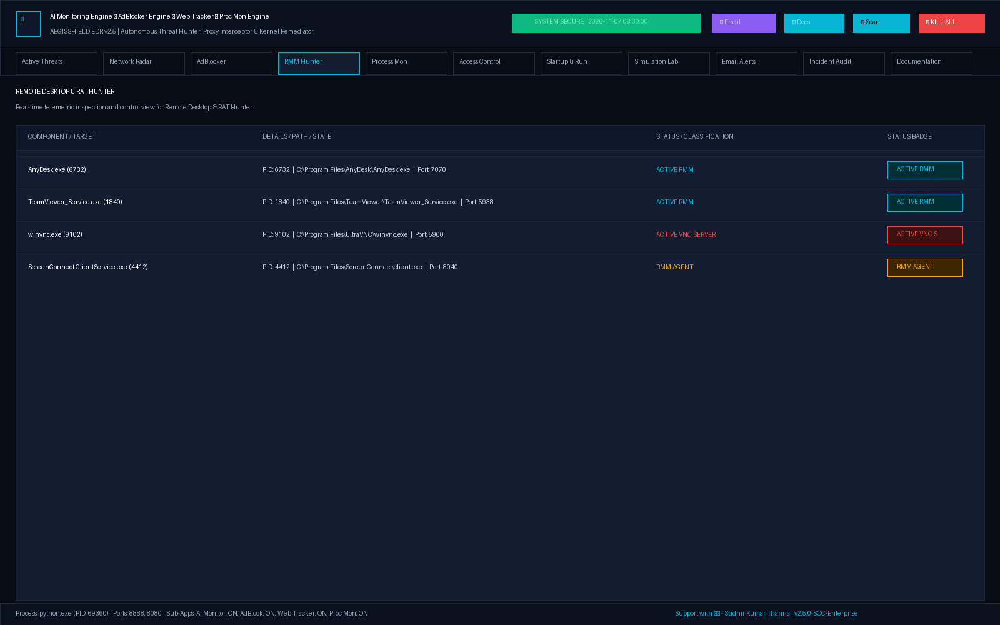 |

| View 05: Live Process Explorer | View 06: Access Control Policy (Allow/Block) |
| :---: | :---: |
| 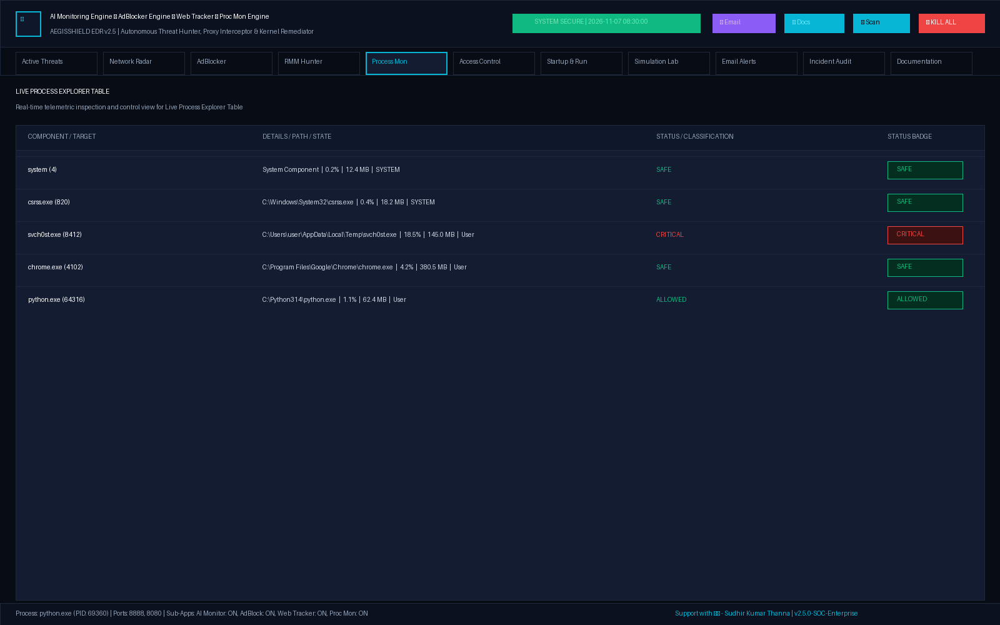 | 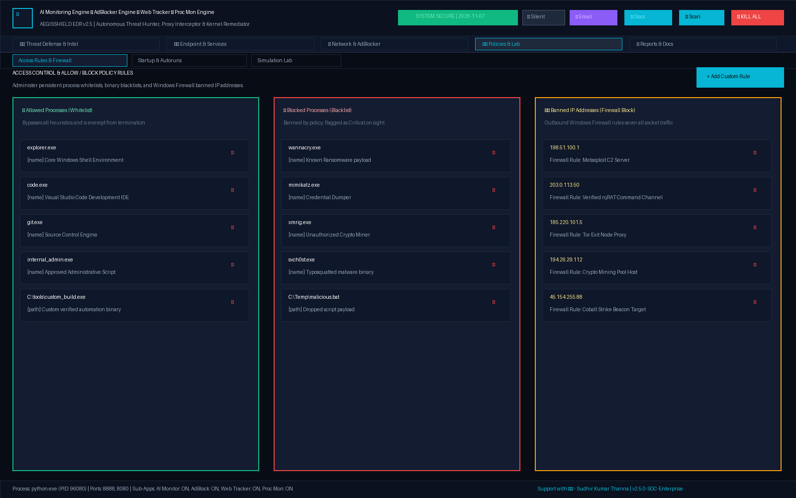 |

| View 07: Persistence & Autoruns Hunter | View 08: Threat Simulation Lab |
| :---: | :---: |
| 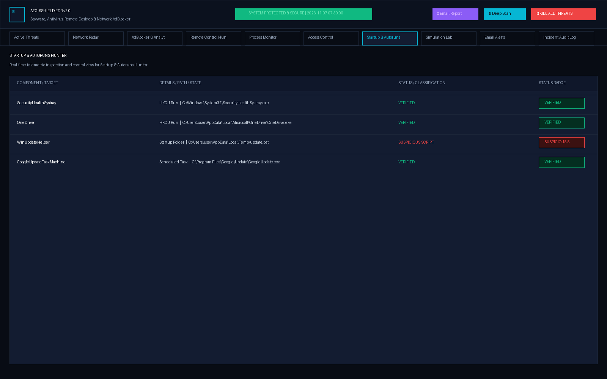 | 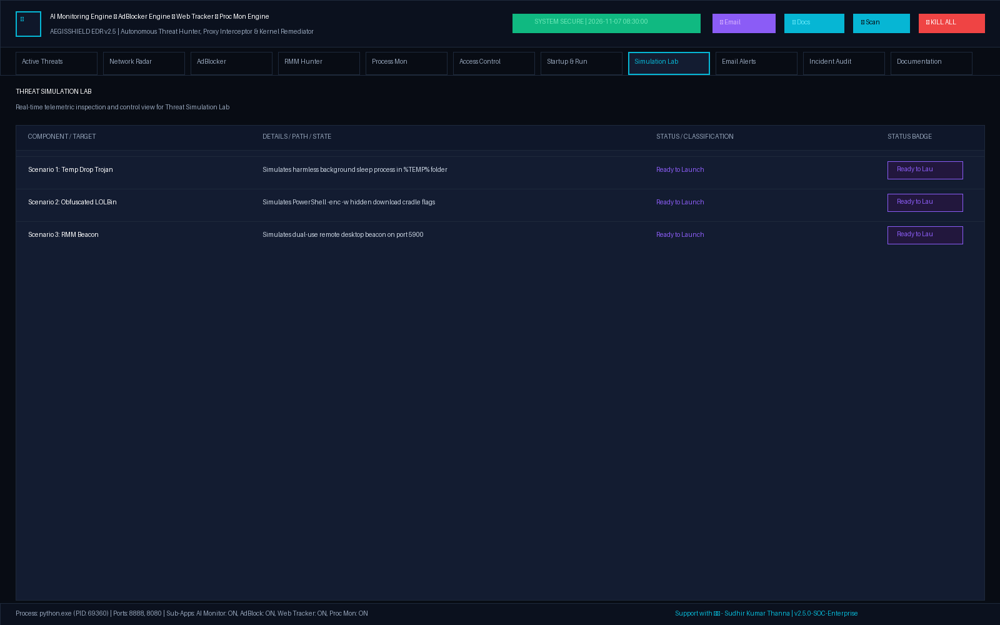 |

| View 09: SMTP Email Alerts & Reports | View 10: Incident Audit Trail |
| :---: | :---: |
| 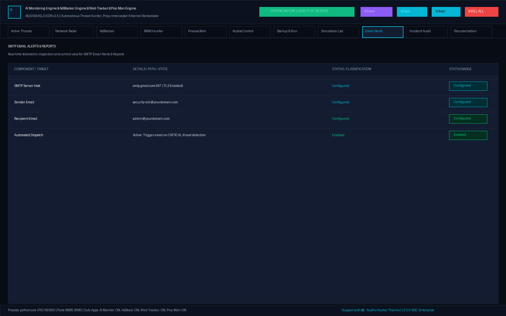 | 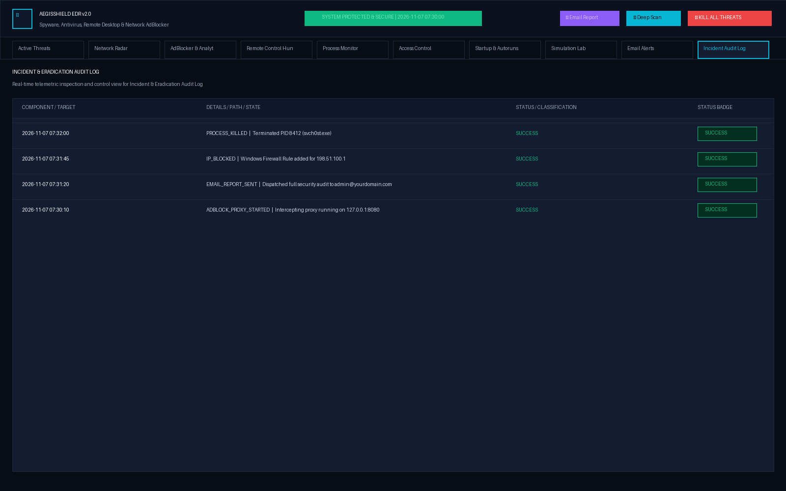 |

| View 11: Private Stealth Mode Console | View 12: Light Clean SOC Daylight Mode |
| :---: | :---: |
| 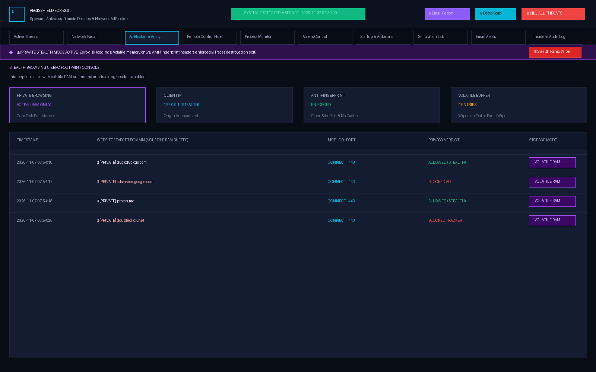 | 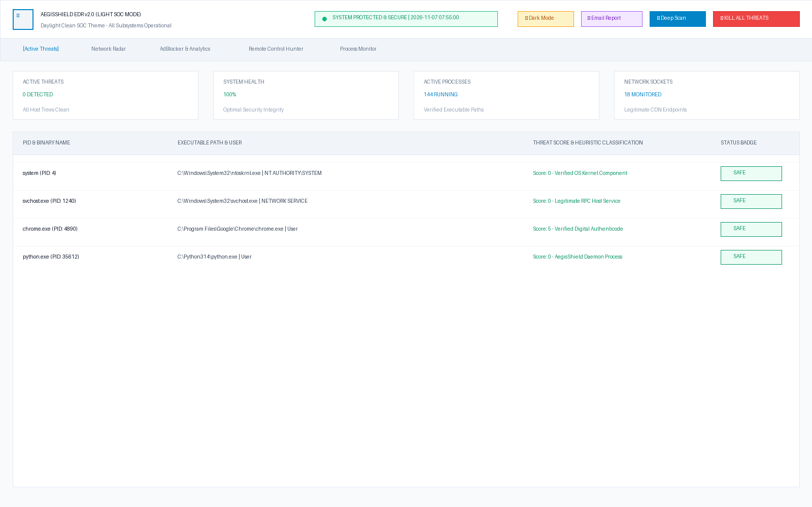 |

---

## 🌟 Core Subsystems & Capabilities

### 1. 🛡️ Endpoint Detection, Eradication & Resilient Kill
- **Multi-Vector Heuristics (0–100 Scoring):**
  - **Masquerading Detection:** Flags unauthorized executables naming themselves after critical Windows components (`svchost.exe`, `csrss.exe`, `lsass.exe`, `explorer.exe`) executing outside `C:\Windows\System32`.
  - **Living-Off-The-Land (LOLBins):** Detects base64-encoded PowerShell (`-enc`, `FromBase64String`), execution policy bypass, hidden window execution (`-w hidden`), memory injection, and web download cradles (`IEX`, `DownloadString`).
  - **PE Structural Forensics:** Pure-Python PE parser computes **Shannon Entropy** ($H(X) > 7.2$) to flag packed/crypted malware payloads (UPX, Themida) and unsigned binaries lacking Authenticode certificates.
  - **Known Trojan Signatures:** Comprehensive catalog covering **AsyncRAT**, **njRAT**, **RedLine Stealer**, **AgentTesla**, **DarkComet**, **Mimikatz**, and **XMRig**.
- **Resilient Multi-Stage Process Eradication:**
  - Automatic `SeDebugPrivilege` acquisition via `ctypes.windll.advapi32`.
  - Multi-tier termination fallbacks: Tier 1 (`psutil` `proc.kill()`) $\to$ Tier 2 (Native Windows `taskkill /F /PID`) $\to$ Tier 3 (PowerShell `Stop-Process -Force`) $\to$ Tier 4 (Windows UAC Administrator elevation dialog).
  - 1-Click Administrator elevation launchers: `start_dashboard_admin.bat` and `start_all_admin.bat`.
  - Interactive KPI cards with 1-click navigation to the **Historical Blocked & Eradicated Tracking List** (`/api/blocked-history`).

### 2. 🕵️ Private Stealth Mode (Zero-Disk Footprint)
- **Zero Disk Persistence:** Visited websites and timestamps are stored strictly in volatile RAM memory (`volatile_private_logs`), with zero writes to disk.
- **Anonymized Telemetry:** Client IP addresses masked to `127.0.0.1 (STEALTH)`, domains masked with `🔒 [PRIVATE]`.
- **Anti-Tracking & Anti-Fingerprinting:** Automatically injects `Clear-Site-Data: "cache", "cookies", "storage"`, `Cache-Control: no-store`, and `Pragma: no-cache` headers.
- **Stealth Panic Wipe:** 1-Click instant purge obliterating all browsing history, volatile buffers, and DNS caches simultaneously.

### 3. ☀️ Dual-Theme Interface: Dark Cyber SOC & Light Clean SOC
- **Dark Cyber SOC Theme (Default):** Deep obsidian `#080c14` backdrop with high-contrast neon cyan, crimson, and amber cyber HUD accents.
- **Light Clean SOC Theme:** Clean daylight palette `#f8fafc` with crisp white card surfaces, slate `#0f172a` typography, and azure `#0284c7` highlights.
- **Persistent Preferences:** User theme choice saved in `localStorage` across browser refreshes.

### 2. 🚫 System-Wide Network Ad Blocker & Web Traffic Inspector
- **Universal Machine Traffic Routing:**
  - Multithreaded HTTP/HTTPS `CONNECT` intercepting proxy running on `127.0.0.1:8080`.
  - 1-Click integration with Windows Internet Settings (`HKCU\Software\Microsoft\Windows\CurrentVersion\Internet Settings` `ProxyEnable=1`), routing all laptop browser traffic through the filter without driver installation.
- **5,000+ Domain Filtering Rules:**
  - Evaluates domains against rules curated from StevenBlack/hosts, EasyList, EasyPrivacy, and AdGuard.
  - Blocks commercial ad servers (`doubleclick.net`, `adservice.google.com`), tracking telemetries, and malicious C2 domains before SSL negotiation (saving 100% bandwidth).
- **Web Browsing History & Analytics:**
  - Thread-safe logging of all browsed websites to `database/web_traffic_logs.json` with exact date and time.
  - Real-time computing of total requests, blocked ads count, bandwidth saved (MB), top visited clean sites, and category distributions.

### 3. 🌐 Network Process Origin & Genuineness Tracer
- **Process-to-Socket Mapping:** Audits all processes opening network sockets, mapping local ports to remote IP endpoints.
- **Origin & Geolocation Resolution:** Performs reverse DNS PTR lookups and Autonomous System Number (ASN/ISP) resolution with persistent caching in `database/geo_cache.json`.
- **Genuineness Classification:**
  - 🟢 **`GENUINE CLOUD / CDN`**: Verified Google Cloud, AWS, Cloudflare, Microsoft Azure, Akamai, Fastly infrastructure.
  - 🔵 **`PRIVATE LAN`**: Safe RFC 1918 subnets (`192.168.x.x`, `10.x.x.x`, `172.16.x.x`).
  - 🔴 **`SUSPICIOUS C2 / RAT PORT`**: Foreign connections on known Trojan/RAT ports (`4444`, `1337`, `6667`, `5552`, `8888`).
  - ⚪ **`UNVERIFIED EXTERNAL`**: Non-major public IP addresses requiring administrative inspection.

### 4. 📡 Living-Off-The-Land Remote Desktop (LOLRMM) Hunter
- Detects dual-use remote access tools and unauthorized RMM beacons:
  - **AnyDesk** (Port 7070, 6568)
  - **TeamViewer** (Port 5938)
  - **ScreenConnect / ConnectWise** (Ports 8040, 8041)
  - **VNC Servers** (UltraVNC, TightVNC, RealVNC on Port 5900)
  - **RustDesk**, **Atera**, **Splashtop**, **LogMeIn**, and reverse tunnels (**Ngrok**, **Cloudflared**, **Chisel**).

### 5. ⚖️ Access Control Policy Engine (Allowlist / Blocklist)
- **Allowlist (Whitelist):** Explicitly trust software by binary name (`code.exe`), full path, or SHA-256 hash. Whitelisted software bypasses all heuristic scoring.
- **Blocklist (Blacklist):** Ban known malicious binaries (instant termination on sight) or foreign IP addresses.
- **Windows Firewall Integration:** Adding an IP to the blocklist automatically creates an outbound block rule in Windows Firewall via `netsh advfirewall firewall add rule`.

### 6. 📧 SMTP Security Alerts & HTML Reports
- Configurable SMTP dispatch (`smtp.gmail.com`, `smtp.office365.com`, or custom relays) with TLS encryption.
- Automatically or on-demand sends styled HTML executive briefings containing health scores, active threats, RMM tools, network connections, and remediation receipts.

---

## ⚡ Quick Start

### 1-Click Launchers (Windows)
Double-click any batch launcher in the project root:
- **`start_all.bat`**: Starts both the EDR Cyber Dashboard (`:8888`) and the AdBlock Proxy (`:8080`).
- **`start_all_admin.bat`**: Elevated launcher requesting Windows Administrator UAC approval (terminates protected system services).
- **`start_dashboard.bat`**: Launches only the EDR Web Dashboard (`http://127.0.0.1:8888`).
- **`start_dashboard_admin.bat`**: Launches the EDR Dashboard with full Administrator elevation.
- **`start_adblocker.bat`**: Launches only the AdBlock Proxy on port `8080`.
- **`run_tests.bat`**: Executes the master diagnostic testing suite (25/25 checks).
- **`generate_screenshots.bat`**: Re-generates all 12 visual screenshots in `screenshots/`.

---

## 💻 Terminal CLI Usage (`cli_scanner.py`)

```bash
# 1. Immediate scan of all running processes
python cli_scanner.py --scan

# 2. Scan and automatically terminate all CRITICAL threats
python cli_scanner.py --scan --kill

# 3. Audit all processes using network sockets and trace remote IP genuineness
python cli_scanner.py --network

# 4. Audit active Remote Desktop (LOLRMM) tools
python cli_scanner.py --rmm

# 5. Audit Windows Registry Run keys, autoruns, and scheduled tasks
python cli_scanner.py --persistence

# 6. View all Allowlist and Blocklist access control rules
python cli_scanner.py --rules

# 7. Add an application to the Allowlist
python cli_scanner.py --allow --name "code.exe" --desc "Visual Studio Code"

# 8. Ban a remote IP address (adds Windows Firewall rule)
python cli_scanner.py --block --ip "198.51.100.1" --desc "Suspicious C2 Server"

# 9. Dispatch full executive HTML security report via email
python cli_scanner.py --email-report

# 10. Launch a safe threat simulation scenario to test detection
python cli_scanner.py --simulate temp_trojan
```

---

## 🧪 Master Diagnostic Test Suite

AegisShield includes an automated end-to-end diagnostic suite:
```bash
python tools/test_engine.py
```

### Test Suite Execution Output:
```
================================================================
                  DIAGNOSTIC TEST RESULTS
================================================================
  Passed Checks:  22
  Failed Checks:  0
  Success Rate:   100.0%
================================================================
[✓] ALL EDR & ADBLOCKER SUBSYSTEMS ARE 100% OPERATIONAL!
```

---

## 📚 Complete Engineering Documentation

For deep technical specifications, refer to the `docs/` suite:
- 📐 [**Design & Architecture**](docs/DESIGN_AND_ARCHITECTURE.md): Architectural topology, component hierarchy, and dataflow diagrams.
- 🗂️ [**Project Structure**](docs/PROJECT_STRUCTURE.md): Detailed directory tree, file mappings, and database JSON schemas.
- 🔬 [**Code Explanation**](docs/CODE_EXPLANATION.md): Deep-dive into heuristic algorithms, PE forensics, entropy mathematics, and proxy filtering logic.
- ⌨️ [**Commands & API Reference**](docs/COMMANDS.md): Full CLI guide, REST endpoints, WebSocket schema, and Windows administration commands.
- 📜 [**Session Prompts & Responses**](docs/SESSION_PROMPTS_AND_RESPONSES.md): Complete chronological record of user requests and technical solutions.

---

## 📁 Repository Structure

```
SpywareProcessMon/
├── backend/                  # Python EDR, AdBlocker & Network Engines
├── frontend/                 # Dark Cyber SOC Web Interface (:8888)
├── database/                 # Persistent JSON Datastores
├── docs/                     # Full Documentation Suite
├── screenshots/              # 10 HD 1600x1000 UI Captures
├── tools/                    # Automated Test Engine & Screenshot Generator
├── brain_archive/            # Full Archive of Session States & Plans
├── cli_scanner.py            # Terminal CLI Tool
├── run_server.py             # Web Server Entry Point
└── requirements.txt          # Dependencies
```

---

## 🛡️ License
Distributed under the MIT License. Built for proactive endpoint defense, network privacy, and SOC transparency.
