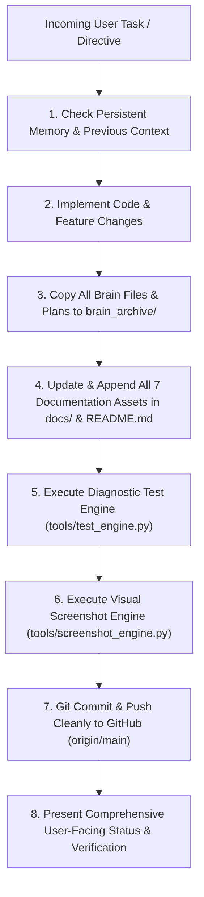

# Antigravity Persistent Memory & Continuous Synchronization Protocol

**Version:** 3.0.0-ENTERPRISE  
**Policy Name:** `CREATE_UPDATE_APPEND_ALWAYS`  
**Effective Date:** 2026-11-07  
**Author / Security Architect:** Sudhir Kumar Thanna  

---

## 1. Core Operating Directive

For **every incoming task, feature addition, bug fix, or analysis**, Antigravity must strictly adhere to the following continuous lifecycle:

---

## 2. Mandatory Memory Rules

1. **Always Append, Never Overwrite Historical Knowledge:**
   - Documentation files (`DESIGN.md`, `ARCHITECTURE.md`, `PROJECT_STRUCTURE.md`, `CODE_EXPLANATION.md`, `COMMANDS.md`, `SESSION_INFO.md`, `SESSION_PROMPTS_AND_RESPONSES.md`, `README.md`) must preserve all prior historical milestones while appending new chapters and updating live status metrics.

2. **Full Brain Synchronization:**
   - Every artifact created in `<appDataDir>\brain\<conversation-id>` (`plan.md`, `adblocker_plan.md`, `continuous_sync_and_memory_protocol.md`) must be mirrored into the project's local `brain_archive/` folder.
   - Transcripts containing credentials or raw tokens must remain gitignored to satisfy GitHub Secret Scanning while sanitized session histories are stored in `docs/SESSION_PROMPTS_AND_RESPONSES.md`.

3. **Subsystem Verification:**
   - No task is marked complete without running `tools/test_engine.py` (minimum 100% pass rate) and verifying the operational status of the live background daemon.

4. **Visual Evidence:**
   - Every major UI or architectural update must be visually captured via `tools/screenshot_engine.py` into `screenshots/` (1600x1000 HD PNGs) and linked in `README.md` and `frontend/docs.html`.

5. **Security & Elevation Principles:**
   - Standard user mode commands execute gracefully with diagnostic hints.
   - Privileged operations (killing protected SYSTEM processes, Windows service termination, raw firewall modifications) provide 1-click UAC elevated execution scripts (`start_all_admin.bat`, `start_dashboard_admin.bat`) and the Interactive Administrator Eradication Modal.

6. **Audio & Notification Sound Policy:**
   - Web notification sounds are permanently disabled / removed by default (`state.soundEnabled = false`).
   - All audio oscillator triggers are gated behind an explicit mute guard (`if (!state.soundEnabled) return;`).
   - A dedicated `#btn-sound-toggle` button in the header provides visual confirmation of Silent Mode.

