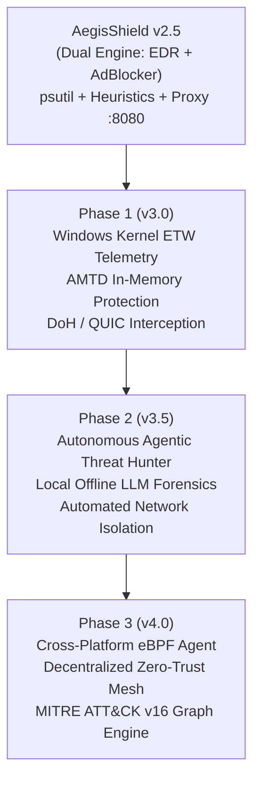

# Strategic Future Scope & Technical Roadmap: AegisShield Enterprise (2026–2027)

**Product Suite:** AI Monitoring Engine • AdBlocker Engine • Web Tracker • Proc Mon Engine  
**Architect:** Sudhir Kumar Thanna  
**Version Horizon:** v3.0.0 — v4.0.0  
**Effective Date:** 2026-11-07  

---

## 1. Executive Vision

As cyber threats evolve beyond traditional file-based malware into fileless in-memory execution, identity-hijacking Living-off-the-Land (LOLBAS) attacks, and multi-cloud C2 beaconing over encrypted protocols (DoH, QUIC, WebSocket tunnels), **AegisShield EDR** is architected to transition from reactive host auditing to **Autonomous Action-in-the-Loop Endpoint Defense**.

---

## 2. Six Strategic Engineering Pillars

### Pillar 1: High-Fidelity Windows Kernel Telemetry (ETW / Microsoft Kernel APIs)
- **Problem:** User-mode process polling via `psutil` or snapshot loops can miss ephemeral sub-second processes spawned by stealth droppers.
- **Solution:** Migrate kernel event capture to **Event Tracing for Windows (ETW)** using `Microsoft-Windows-Kernel-Process`, `Microsoft-Windows-Kernel-Network`, and `Microsoft-Windows-Kernel-File`.
- **Outcome:** Sub-millisecond process creation capture, DLL injection detection, and kernel handle auditing with zero crash risk (no unverified kernel drivers).

### Pillar 2: Autonomous Action-in-the-Loop Disruption
- **Automated Host Quarantine:** Immediate software-defined network isolation via Windows Filtering Platform (WFP) or Netsh, severing external C2 connectivity while keeping loopback SOC telemetry active.
- **Micro-Token Suspension:** Freezing hostile threads before memory wiping occurs.
- **Zero-Touch Rollback:** VSS shadow copy preservation and automated registry restoration for ransomware precursor events.

### Pillar 3: Next-Gen System-Wide AdBlocker (QUIC, HTTP/3 & Encrypted DNS)
- **DoH / DoT Privacy Sinkhole:** Local recursive DNS resolver intercepting DNS-over-HTTPS (DoH) and DNS-over-TLS (DoT) queries to prevent malicious beaconing via encrypted DNS.
- **eBPF / WFP Transparent Socket Redirection:** Redirecting outbound traffic to port 8080 transparently at the kernel TCP stack without manual proxy configuration.
- **QUIC / HTTP/3 UDP Inspection:** Deep packet inspection for UDP port 443 web traffic.

### Pillar 4: Automated Moving Target Defense (AMTD) & In-Memory Shielding
- Dynamic memory space randomization to confuse exploitation payloads (ROP chains, buffer overflows).
- In-memory AMSI (Antimalware Scan Interface) hook verification and unhooking detection to thwart PowerShell and VBScript evasion.

### Pillar 5: Local On-Device Agentic AI Hunter
- Offline lightweight SLM (Small Language Model e.g. Gemma 2B / Phi-3) executing directly on the endpoint via ONNX Runtime / DirectML.
- Continuous autonomous correlation of benign administrative behaviors versus lateral movement patterns.
- Automated human-readable incident root-cause reports generated locally without internet dependencies.

### Pillar 6: Cross-Platform eBPF Observability (Linux & macOS)
- Standardized sensor agent powered by Extended Berkeley Packet Filter (eBPF) for containerized Kubernetes workloads, Ubuntu, Debian, and macOS endpoints.
