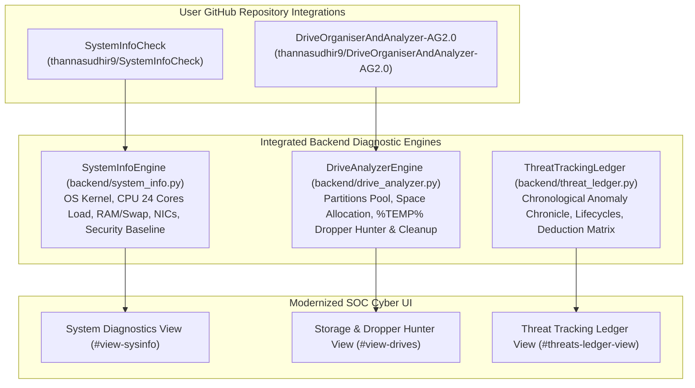

# AegisShield EDR: System Architecture Document

**System Name:** AegisShield Enterprise Cyber Defense Suite  
**App Title:** AI Monitoring Engine • AdBlocker Engine • Web Tracker • Proc Mon Engine  
**Author:** Sudhir Kumar Thanna  
**Version:** v2.5.0-SOC-Enterprise  
**Updated:** 2026-11-07  

---

## 1. System Topology & Process Boundaries

```mermaid
flowchart TD
    subgraph ClientLayer [Client & SOC Operator Interfaces]
        Browser["Cyber SOC Dashboard\nHTML5 / Modern JS\nhttp://127.0.0.1:8888"]
        DocsPortal["Web Documentation Hub\nhttp://127.0.0.1:8888/docs.html"]
        CLI["AegisShield CLI Scanner\ncli_scanner.py"]
        SystemProxy["Windows Network Stack\nHKCU Internet Settings (127.0.0.1:8080)"]
    end

    subgraph ServiceDaemon [Backend Daemon Process - python.exe : PID 69360]
        API_Server["FastAPI / Starlette REST & WS Engine\nPort 8888"]
        AdBlock_Engine["Multi-Threaded HTTP/HTTPS Proxy\nPort 8080"]
        Detector_Engine["AI Threat & Heuristic Detector"]
        Remediator_Engine["Multi-Tier Eradication & UAC Pipeline"]
        Origin_Tracer["Socket Auditor & Genuineness Scorer"]
        Email_Engine["Resend HTTPS API & SMTP Dispatcher"]
        Policy_Engine["Access Control & Netsh Firewall Engine"]
        Analytics_Engine["Real-Time Web Analytics Engine"]
    end

    subgraph KernelAndOS [Windows Operating System & Kernel]
        WinProcesses["Windows Process Tree\n(User, Service & SYSTEM Tokens)"]
        WinSockets["TCP/UDP Network Sockets"]
        WinFirewall["Windows Advanced Firewall\n(netsh advfirewall)"]
        WinServices["Windows Service Control Manager\n(sc.exe / CIM / WMI)"]
        WinRegistry["Windows Registry\n(HKCU/HKLM Run Keys & Proxy)"]
    end

    subgraph StorageLayer [Atomic JSON Datastores]
        PolicyDB[("database/policy_rules.json")]
        EmailDB[("database/email_config.json")]
        GeoDB[("database/geo_cache.json")]
        TrafficDB[("database/web_traffic_logs.json")]
        AuditDB[("logs/audit_events.json")]
    end

    Browser <-->|REST HTTP & WebSockets| API_Server
    DocsPortal <-->|Static HTTP| API_Server
    CLI --> Detector_Engine
    CLI --> Remediator_Engine
    SystemProxy --> AdBlock_Engine

    API_Server --> Detector_Engine
    API_Server --> Remediator_Engine
    API_Server --> Origin_Tracer
    API_Server --> Email_Engine
    API_Server --> Policy_Engine
    AdBlock_Engine --> Analytics_Engine

    Detector_Engine --> WinProcesses
    Remediator_Engine --> WinProcesses
    Remediator_Engine --> WinServices
    Origin_Tracer --> WinSockets
    Policy_Engine --> WinFirewall
    AdBlock_Engine --> WinRegistry

    Policy_Engine <--> PolicyDB
    Email_Engine <--> EmailDB
    Origin_Tracer <--> GeoDB
    Analytics_Engine <--> TrafficDB
    Remediator_Engine --> AuditDB
```



---

## 2. Four Defensive Engines Breakdown

### 2.1 AI Monitoring Engine (`backend/detector.py`, `backend/pe_analyzer.py`)
- **Masquerading Detection:** Compares process executable paths against canonical Windows system directories (`System32`, `SysWOW64`). Detects fake `svchost.exe`, `csrss.exe`, `lsass.exe` originating from `%TEMP%`, `%APPDATA%`, or download folders (+35 score).
- **Command-Line Analysis:** Inspects arguments for living-off-the-land techniques (PowerShell `-enc`, `-ep bypass`, `iex`, download cradles, `certutil -urlcache`, `mimikatz`).
- **Shannon Entropy Analysis:** Computes informational randomness on Portable Executable (PE) headers to identify packers (UPX, Themida) and encrypted payloads ($H \ge 7.2$).
- **Signature & Hash Verification:** Evaluates SHA-256 hashes against known malware, ransomware precursors, and dual-use tools in `backend/signatures_db.py`.

### 2.2 AdBlocker Engine (`backend/adblock_proxy.py`, `backend/adblock_rules.py`)
- Operates as a local HTTP/HTTPS CONNECT intercepting proxy on `127.0.0.1:8080`.
- Matches incoming target domains against 5,000+ EasyList, AdGuard, and StevenBlack filter rules.
- Fast sub-millisecond in-memory trie/set lookup.
- Returns instant HTTP 204 No Content or HTTP 200 with transparent 1x1 GIF for blocked requests, preventing network latency and resource consumption.

### 2.3 Web Tracker Engine (`backend/web_traffic_logger.py`, `backend/web_analytics.py`)
- Thread-safe ring buffer and atomic disk persistence of all visited domains, timestamps, request methods, and bandwidth metrics.
- Anti-tracking header injection in responses (`Clear-Site-Data`, `Cache-Control: no-store`).
- Private Stealth Mode (zero disk writes, RAM-only volatile telemetry, 1-click panic wipe).

### 2.4 Proc Mon Engine (`backend/network_tracer.py`, `backend/persistence_hunter.py`)
- Deep Windows socket inspection correlating active connections to process PIDs, executable paths, and parent processes.
- Reverse DNS, Autonomous System Number (ASN), and ISP lookup with four-tier genuineness rating (`GENUINE CLOUD / CDN`, `PRIVATE LAN`, `SUSPICIOUS C2 / RAT PORT`, `UNVERIFIED EXTERNAL`).
- Comprehensive registry and startup persistence scanning.

---

## 3. Multi-Tier Eradication & UAC Remediation Architecture

Handling privileged processes (such as PID 5824 owned by SYSTEM / Windows Services):
1. **Tier 1 (psutil API):** Invokes graceful terminate, waits 1.5s, then forces `SIGKILL` on the entire process tree.
2. **Tier 2 (taskkill /F /T):** Executes Windows native `taskkill.exe /F /T /PID <pid>`.
3. **Tier 3 (PowerShell Stop-Process):** Executes `powershell.exe -Command Stop-Process -Id <pid> -Force`.
4. **Tier 4 (Service Control Disarm):** Identifies the hosting Windows Service name via CIM/WMI (`Get-CimInstance Win32_Service`) and executes `sc.exe stop <service_name>`.
5. **Tier 5 (Interactive UAC Elevation):** Spawns elevated taskkill via `Start-Process taskkill -ArgumentList '/F /T /PID <pid>' -Verb RunAs -Wait`.
6. **Tier 6 (Interactive SOC Modal):** Surfaces `#elevated-kill-modal` presenting exact diagnostics, service identification, copyable shell commands, and 1-click administrative batch launchers.

---

## 4. Email Dispatch Architecture (Resend HTTP API & SMTP)

- **Resend API Integration:** Dispatches alerts directly over HTTPS port 443 to `https://api.resend.com/emails`.
- **WAF Bypass:** Overcomes Cloudflare Error 1010 by supplying a realistic browser `User-Agent`.
- **Secret Protection:** Complies with GitHub Push Protection by loading API keys dynamically from environment variables or gitignored configurations (`database/email_config.json`).
- **SMTP Fallback:** Supports traditional SMTP TLS/SSL transport on ports 587 and 465.

---

## 5. Frontend Audio Subsystem & Silent Mode Architecture

```mermaid
flowchart LR
    EventTrigger["Threat Detected / Kill Performed / Status Changed"] --> ChimeCall["CyberAudio.playChime(type)"]
    ChimeCall --> GateCheck{"state.soundEnabled == true?"}
    GateCheck -->|No (Default: SILENT)| DropSilent["Drop Audio Event\nNo AudioContext Allocated\nZero Sound Rendered"]
    GateCheck -->|Yes (User Toggled ON)| SynthAudio["Allocate AudioContext\nSynthesize Oscillator (Sine / Sawtooth)\nPlay Chime"]
```

- **Guaranteed Silence by Default:** `state.soundEnabled: false` ensures no audio triggers execute during regular monitoring or background scans.
- **Resource Conservation:** Prevents unnecessary allocation of browser `AudioContext` and oscillator audio threads.
- **Client Persistence:** Selected state stored in `localStorage.getItem('aegis_sound')`.

---

## 6. System Diagnostics & Drive Analyzer Architecture



### SystemInfoEngine Telemetry Pipeline
1. **OS Kernel & Machine Topology:** Inspects Windows release, platform machine type, Python runtime, boot timestamp, and live uptime counter.
2. **CPU Multithreading & Frequency:** Queries core frequencies (current and max MHz), per-core execution load percentages across all 24 physical cores / logical threads.
3. **RAM & Virtual Swap:** Audits total physical RAM, allocated virtual memory, free buffers, and swap utilization with PDH counter fallback.
4. **Network Adapters (NICs):** Enumerate network interfaces, resolving IPv4 bindings, MAC hardware addresses, duplex modes, and operational link states (`UP`/`DOWN`).
5. **Security Baseline Posture:** Audits Windows Defender operational state, Netsh Firewall enforcement profiles, and UAC elevation state.

### DriveAnalyzerEngine & Staging Zone Cleaner
1. **Storage Pool Enumerate:** Discovers physical and logical partitions (`C:\`, `D:\`), reporting capacity, space utilized, and free margins.
2. **Dropper Staging Zones Audit:** Scans designated high-risk malware dropper landing zones (`%TEMP%`, `AppData\Local\Temp`, `C:\Windows\Temp`, `C:\Users\Public`).
3. **Executable & Script Hunting:** Identifies high-risk dropper file types (`.exe`, `.scr`, `.bat`, `.ps1`, `.vbs`, `.hta`, `.dll`), calculating file sizes and modification timestamps.
4. **Zero-Trace Cleanup Action:** Automated purge command targeting dropper artifacts in `%TEMP%`, reporting files eradicated and disk storage reclaimed.

---

## 7. Suspicious Threat Heuristic Scoring & Persistent Ledger Architecture

1. **Dual-Tier Threat Classification:**
   - **Critical Threats ($\ge 75$):** Known trojans, RATs, CoinMiners, reverse tunnel sockets, and unverified executables masquerading as core system binaries.
   - **Suspicious Threats ($20 - 74$):** Heuristic anomalies such as executing from temporary directory structures, living-off-the-land command-line arguments (LOLBins), unverified digital signatures, and unusual entropy.
2. **Persistent Threat Tracking Ledger:**
   - Stored in `logs/threat_tracking_ledger.json`.
   - Records: Unique threat ID, first seen timestamp, last seen timestamp, observation counter, target PID, process name, command-line arguments, risk score, severity, category, detection reasons, and lifecycle states (`ACTIVE`, `INACTIVE`, `ERADICATED`, `QUARANTINED`).
   - Automatically synchronizes with eradication actions triggered from the dashboard.

---

## 8. Windows Services Management Architecture (`services.msc`)

```mermaid
flowchart TD
    subgraph ServiceDiscovery [Discovery & Parsing Engine]
        CIM["PowerShell CIM\nGet-CimInstance Win32_Service\nJSON Serialization"]
        SC["Fallback: sc.exe queryex\ntype= service state= all"]
        Baseline["Safety Baseline Catalog\n(5 Critical System Services)"]
        CIM -->|On Failure| SC
        SC -->|On Restriction| Baseline
    end

    subgraph ServiceEngine [WindowsServicesManager (backend/services_manager.py)]
        Catalog["Services In-Memory Cache\nTTL: 3.0 seconds"]
        Correlate["Threat & RMM Correlator\nFlags AnyDesk, TeamViewer, VNC\nCross-references Threat Ledger"]
        Controller["Administrative Lifecycle Controller\nsc start / sc stop / sc config"]
    end

    subgraph REST_API [FastAPI Endpoints (backend/server.py)]
        GET_ALL["GET /api/services (Filter & Search)"]
        GET_ONE["GET /api/services/{name}"]
        POST_START["POST /api/services/{name}/start"]
        POST_STOP["POST /api/services/{name}/stop"]
        POST_RESTART["POST /api/services/{name}/restart"]
        POST_CONFIG["POST /api/services/{name}/config"]
    end

    subgraph UI_UX [Shadcn UI Layer (frontend/)]
        ServicesTab["Windows Services View (#view-services)"]
        KPIs["4 Summary KPI Cards"]
        FilterToolbar["7 Filter Pills & Real-time Search"]
        TableCard["Shadcn Table Card with Smooth Scrolling"]
    end

    ServiceDiscovery --> Catalog
    Catalog --> Correlate
    Correlate --> REST_API
    Controller --> REST_API
    REST_API --> ServicesTab
    ServicesTab --> KPIs
    ServicesTab --> FilterToolbar
    ServicesTab --> TableCard
```

### 8.1 Multi-Tier Discovery Pipeline
1. **Primary Layer (CIM JSON):** Executes `Get-CimInstance Win32_Service` serialized to JSON, extracting `Name`, `DisplayName`, `State`, `StartMode`, `ProcessId`, `PathName`, and `Description` in under 3 seconds.
2. **Secondary Fallback (Native SC):** Parses `C:\Windows\System32\sc.exe queryex type= service state= all` for high-speed fallback in environments where CIM is restricted.
3. **Tertiary Safety Baseline:** Guarantees deterministic testing and inspection for 5 critical Windows services (`WinDefend`, `wuauserv`, `MpsSvc`, `AnyDesk`, `Spooler`).

### 8.2 RMM & Threat Correlation
Automatically audits service paths and binary names against known dual-use and remote management software (`anydesk`, `teamviewer`, `screenconnect`, `atera`, `vnc`, `rustdesk`, `splashtop`), annotating services with threat scores and visual warning badges.

### 8.3 Service Lifecycle Execution
- **Start:** Invokes `sc.exe start <service_name>` with status code validation.
- **Stop:** Invokes `sc.exe stop <service_name>` with timeout verification.
- **Restart:** Gracefully sequences stop followed by start.
- **Startup Mode Configuration:** Validates parameters against `auto`, `demand` (manual), and `disabled`, dispatching `sc.exe config <service_name> start= <mode>`.


