# AegisShield EDR: System Architecture Document

**System Name:** AegisShield Enterprise Cyber Defense Suite  
**App Title:** AI Monitoring Engine • AdBlocker Engine • Web Tracker • Proc Mon Engine  
**Author:** Sudhir Kumar Thanna  
**Version:** v2.5.0-SOC-Enterprise  
**Updated:** 2026-11-07  

---

## 1. System Topology & Process Boundaries

```mermaid
flowchart TD
    subgraph ClientLayer [Client & SOC Operator Interfaces]
        Browser["Cyber SOC Dashboard\nHTML5 / Modern JS\nhttp://127.0.0.1:8888"]
        DocsPortal["Web Documentation Hub\nhttp://127.0.0.1:8888/docs.html"]
        CLI["AegisShield CLI Scanner\ncli_scanner.py"]
        SystemProxy["Windows Network Stack\nHKCU Internet Settings (127.0.0.1:8080)"]
    end

    subgraph ServiceDaemon [Backend Daemon Process - python.exe : PID 69360]
        API_Server["FastAPI / Starlette REST & WS Engine\nPort 8888"]
        AdBlock_Engine["Multi-Threaded HTTP/HTTPS Proxy\nPort 8080"]
        Detector_Engine["AI Threat & Heuristic Detector"]
        Remediator_Engine["Multi-Tier Eradication & UAC Pipeline"]
        Origin_Tracer["Socket Auditor & Genuineness Scorer"]
        Email_Engine["Resend HTTPS API & SMTP Dispatcher"]
        Policy_Engine["Access Control & Netsh Firewall Engine"]
        Analytics_Engine["Real-Time Web Analytics Engine"]
    end

    subgraph KernelAndOS [Windows Operating System & Kernel]
        WinProcesses["Windows Process Tree\n(User, Service & SYSTEM Tokens)"]
        WinSockets["TCP/UDP Network Sockets"]
        WinFirewall["Windows Advanced Firewall\n(netsh advfirewall)"]
        WinServices["Windows Service Control Manager\n(sc.exe / CIM / WMI)"]
        WinRegistry["Windows Registry\n(HKCU/HKLM Run Keys & Proxy)"]
    end

    subgraph StorageLayer [Atomic JSON Datastores]
        PolicyDB[("database/policy_rules.json")]
        EmailDB[("database/email_config.json")]
        GeoDB[("database/geo_cache.json")]
        TrafficDB[("database/web_traffic_logs.json")]
        AuditDB[("logs/audit_events.json")]
    end

    Browser <-->|REST HTTP & WebSockets| API_Server
    DocsPortal <-->|Static HTTP| API_Server
    CLI --> Detector_Engine
    CLI --> Remediator_Engine
    SystemProxy --> AdBlock_Engine

    API_Server --> Detector_Engine
    API_Server --> Remediator_Engine
    API_Server --> Origin_Tracer
    API_Server --> Email_Engine
    API_Server --> Policy_Engine
    AdBlock_Engine --> Analytics_Engine

    Detector_Engine --> WinProcesses
    Remediator_Engine --> WinProcesses
    Remediator_Engine --> WinServices
    Origin_Tracer --> WinSockets
    Policy_Engine --> WinFirewall
    AdBlock_Engine --> WinRegistry

    Policy_Engine <--> PolicyDB
    Email_Engine <--> EmailDB
    Origin_Tracer <--> GeoDB
    Analytics_Engine <--> TrafficDB
    Remediator_Engine --> AuditDB
```

---

## 2. Four Defensive Engines Breakdown

### 2.1 AI Monitoring Engine (`backend/detector.py`, `backend/pe_analyzer.py`)
- **Masquerading Detection:** Compares process executable paths against canonical Windows system directories (`System32`, `SysWOW64`). Detects fake `svchost.exe`, `csrss.exe`, `lsass.exe` originating from `%TEMP%`, `%APPDATA%`, or download folders (+35 score).
- **Command-Line Analysis:** Inspects arguments for living-off-the-land techniques (PowerShell `-enc`, `-ep bypass`, `iex`, download cradles, `certutil -urlcache`, `mimikatz`).
- **Shannon Entropy Analysis:** Computes informational randomness on Portable Executable (PE) headers to identify packers (UPX, Themida) and encrypted payloads ($H \ge 7.2$).
- **Signature & Hash Verification:** Evaluates SHA-256 hashes against known malware, ransomware precursors, and dual-use tools in `backend/signatures_db.py`.

### 2.2 AdBlocker Engine (`backend/adblock_proxy.py`, `backend/adblock_rules.py`)
- Operates as a local HTTP/HTTPS CONNECT intercepting proxy on `127.0.0.1:8080`.
- Matches incoming target domains against 5,000+ EasyList, AdGuard, and StevenBlack filter rules.
- Fast sub-millisecond in-memory trie/set lookup.
- Returns instant HTTP 204 No Content or HTTP 200 with transparent 1x1 GIF for blocked requests, preventing network latency and resource consumption.

### 2.3 Web Tracker Engine (`backend/web_traffic_logger.py`, `backend/web_analytics.py`)
- Thread-safe ring buffer and atomic disk persistence of all visited domains, timestamps, request methods, and bandwidth metrics.
- Anti-tracking header injection in responses (`Clear-Site-Data`, `Cache-Control: no-store`).
- Private Stealth Mode (zero disk writes, RAM-only volatile telemetry, 1-click panic wipe).

### 2.4 Proc Mon Engine (`backend/network_tracer.py`, `backend/persistence_hunter.py`)
- Deep Windows socket inspection correlating active connections to process PIDs, executable paths, and parent processes.
- Reverse DNS, Autonomous System Number (ASN), and ISP lookup with four-tier genuineness rating (`GENUINE CLOUD / CDN`, `PRIVATE LAN`, `SUSPICIOUS C2 / RAT PORT`, `UNVERIFIED EXTERNAL`).
- Comprehensive registry and startup persistence scanning.

---

## 3. Multi-Tier Eradication & UAC Remediation Architecture

Handling privileged processes (such as PID 5824 owned by SYSTEM / Windows Services):
1. **Tier 1 (psutil API):** Invokes graceful terminate, waits 1.5s, then forces `SIGKILL` on the entire process tree.
2. **Tier 2 (taskkill /F /T):** Executes Windows native `taskkill.exe /F /T /PID <pid>`.
3. **Tier 3 (PowerShell Stop-Process):** Executes `powershell.exe -Command Stop-Process -Id <pid> -Force`.
4. **Tier 4 (Service Control Disarm):** Identifies the hosting Windows Service name via CIM/WMI (`Get-CimInstance Win32_Service`) and executes `sc.exe stop <service_name>`.
5. **Tier 5 (Interactive UAC Elevation):** Spawns elevated taskkill via `Start-Process taskkill -ArgumentList '/F /T /PID <pid>' -Verb RunAs -Wait`.
6. **Tier 6 (Interactive SOC Modal):** Surfaces `#elevated-kill-modal` presenting exact diagnostics, service identification, copyable shell commands, and 1-click administrative batch launchers.

---

## 4. Email Dispatch Architecture (Resend HTTP API & SMTP)

- **Resend API Integration:** Dispatches alerts directly over HTTPS port 443 to `https://api.resend.com/emails`.
- **WAF Bypass:** Overcomes Cloudflare Error 1010 by supplying a realistic browser `User-Agent`.
- **Secret Protection:** Complies with GitHub Push Protection by loading API keys dynamically from environment variables or gitignored configurations (`database/email_config.json`).
- **SMTP Fallback:** Supports traditional SMTP TLS/SSL transport on ports 587 and 465.
