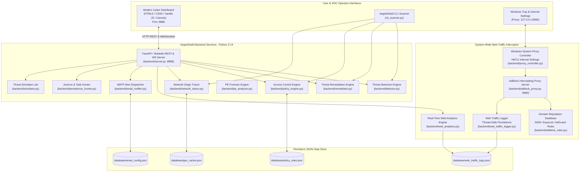
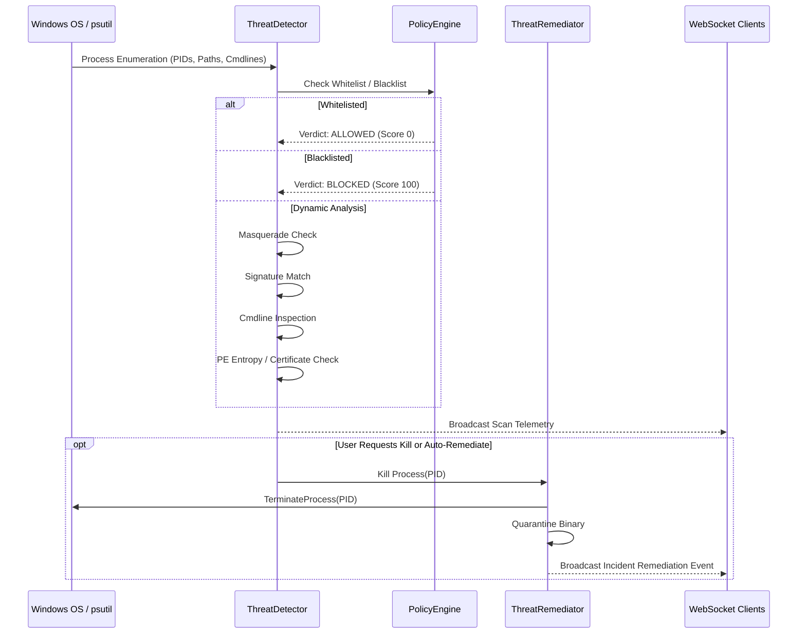

# AegisShield EDR & Network AdBlocker: Design & Architecture

## 1. Executive Overview

**AegisShield EDR** is a dual-engine cyber defense suite for Windows environments that unifies:
1. **Endpoint Detection and Response (EDR):** Detects and eradicates Spyware, Antivirus evasion, Malware, Trojans, Ransomware precursors, and dual-use Remote Desktop & Remote Monitoring & Management (LOLRMM) tools.
2. **System-Wide Network Ad Blocker & Web Traffic Inspector:** Routes all laptop/machine web traffic through a local high-performance intercepting HTTP/HTTPS proxy, terminates ad and tracker telemetry, logs all visited websites with precise timestamps and metrics, and displays real-time analytics.
3. **Network Process Origin & Genuineness Tracer:** Audits every process opening sockets, inspects foreign IP addresses, performs reverse DNS and ASN lookups, and scores the genuineness of endpoints (distinguishing legitimate CDNs/Cloud providers from suspicious C2/RAT beacons).
4. **Access Control Policy Engine:** Allows or blocks processes by executable name, absolute path, SHA-256 hash, and remote IP addresses (with dynamic Windows Firewall synchronization via `netsh`).
5. **Incident Eradication & Email Reporting:** Enables immediate termination of hostile processes and dispatches executive HTML incident alerts via SMTP with full forensic diagnostics.

---

## 2. High-Level System Architecture



---

## 3. Subsystem Breakdown

### 3.1 Threat Detection & Remediation Engine
- **Process Enumeration:** Discovers all active Windows processes using `psutil`.
- **Heuristic Scoring Model (0–100):**
  - **Masquerading / Path Deviation (Score +35):** Detects processes claiming to be critical Windows binaries (`svchost.exe`, `csrss.exe`, `lsass.exe`, `explorer.exe`) executing from unauthorized folders (e.g., `%TEMP%`, `%APPDATA%`, `C:\Users\*`).
  - **Known Trojan / Malware Signatures (Score +45):** Matches against an extensive library of signatures (`njrat.exe`, `asyncrat.exe`, `redline.exe`, `agenttesla.exe`, `darkcomet.exe`, `mimikatz.exe`, `xmrig.exe`).
  - **Suspicious Command-Line Arguments (Score +30):** Flags encoded PowerShell (`-enc`, `FromBase64String`), hidden windows (`-w hidden`), bypass flags (`-ep bypass`), memory injection, and download cradles (`IEX`, `DownloadString`).
  - **PE Structural Anomalies (Score +20):** Computes Shannon entropy of executable sections (high entropy indicates packers/cryptors like UPX, Themida), flags unsigned binaries, and missing version resources.
  - **LOLRMM Tool Identification:** Identifies dual-use remote access tools (`AnyDesk`, `TeamViewer`, `ScreenConnect`, `VNC`, `Atera`, `Splashtop`, `RustDesk`) by signature and default listening ports (`5938`, `7070`, `5900`, `8040`).
- **Remediation:**
  - Performs graceful process shutdown, followed by immediate kernel-level termination (`SIGKILL` / `TerminateProcess`).
  - Quarantines threat binaries to `.quarantine/` with access restrictions and `.quarantine` file extensions.
  - Emits real-time audit records into `database/incident_audit.json`.



---

### 3.2 Network Ad Blocker & System-Wide Web Proxy
- **Traffic Interception Architecture:**
  - Runs a multithreaded HTTP/HTTPS `CONNECT` proxy on `127.0.0.1:8080`.
  - Configures Windows Internet Settings (`HKCU\Software\Microsoft\Windows\CurrentVersion\Internet Settings\ProxyEnable = 1`) with 1-click activation.
  - Avoids port 53 UDP conflicts on Windows (`Dnscache` lock) by operating directly at the web transport layer.
- **Filtering Logic:**
  - Evaluates requested hosts against a curated database of **5,000+ domain patterns** sourced from StevenBlack hosts, EasyList, EasyPrivacy, and AdGuard.
  - Recognizes ad servers (`adservice.google.com`, `doubleclick.net`, `criteo.com`), telemetry endpoints (`telemetry.microsoft.com`), malicious tracking domains, and suspicious C2 hosts.
  - **Blocking Action:**
    - For HTTPS (`CONNECT` requests): Responds with `HTTP/1.1 403 Forbidden` and terminates the connection before SSL negotiation, preventing any byte transfer.
    - For HTTP (`GET`/`POST` requests): Returns a lightweight HTML "AegisShield Blocked Ad" notice.
- **Logging & Analytics:**
  - Persists each request in `database/web_traffic_logs.json` with domain, method, exact timestamp, category (`AD / TRACKER`, `TELEMETRY`, `MALWARE`, `CLEAN / ALLOWED`), block status, and byte counts.
  - Aggregates top visited clean sites, top blocked ad networks, bandwidth saved (bytes prevented), and hourly traffic distributions.

```mermaid
sequenceDiagram
    participant Browser as Web Browser (Chrome, Edge, Firefox)
    participant Proxy as AegisShield Proxy (127.0.0.1:8080)
    participant Engine as AdBlock Rules Engine
    participant Logger as WebTrafficLogger
    participant Web as Target Web Server

    Browser->>Proxy: CONNECT adservice.google.com:443 HTTP/1.1
    Proxy->>Engine: check_domain_reputation("adservice.google.com")
    Engine-->>Proxy: BLOCKED ("Known Ad Network")
    Proxy->>Logger: Log Event (BLOCKED, Ad/Tracker, Timestamp)
    Proxy-->>Browser: HTTP/1.1 403 Forbidden\r\n\r\n
    Note over Browser,Proxy: Connection Closed (Ad Eliminated)

    Browser->>Proxy: CONNECT github.com:443 HTTP/1.1
    Proxy->>Engine: check_domain_reputation("github.com")
    Engine-->>Proxy: ALLOWED ("Clean Domain")
    Proxy->>Logger: Log Event (ALLOWED, Clean, Timestamp)
    Proxy->>Web: Establish TCP Handshake to github.com:443
    Web-->>Proxy: TCP Connected
    Proxy-->>Browser: HTTP/1.1 200 Connection Established\r\n\r\n
    Browser<-->>Web: Direct TLS Tunnel Through Proxy
```

---

### 3.3 Network Process Origin & Genuineness Tracer
- **Socket Enumeration:** Scans all established TCP/UDP connections across running processes.
- **Origin Investigation:**
  - Extracts foreign IP addresses and filters loopback (`127.0.0.1`) and private LAN ranges (`10.0.0.0/8`, `172.16.0.0/12`, `192.168.0.0/16`).
  - Queries local PTR records and reverse DNS for hostnames.
  - Queries ASN / ISP databases (with caching in `database/geo_cache.json` to prevent rate-limiting).
- **Genuineness Classification:**
  - **`GENUINE CLOUD / CDN`:** Verified Google Cloud, AWS, Cloudflare, Microsoft Azure, Akamai, Fastly infrastructure.
  - **`PRIVATE LAN`:** Internal trusted network devices.
  - **`SUSPICIOUS C2 / RAT PORT`:** External connections on common Trojan/RAT ports (`4444`, `1337`, `6667`, `5552`, `8888`).
  - **`UNVERIFIED EXTERNAL`:** Non-major hosting providers or anonymous VPS providers.

---

### 3.4 Access Control Policy Engine
- **Allowlist / Whitelist:**
  - Rules can match by **Binary Name** (`code.exe`), **Full Executable Path** (`C:\Program Files\...`), or **SHA-256 Hash**.
  - Whitelisted processes bypass all heuristic scoring.
- **Blocklist / Blacklist:**
  - Blocked binaries are instantly terminated upon detection.
  - Blocked IP addresses trigger automatic Windows Firewall rules via `netsh advfirewall firewall add rule`.
- **Persistence:** Rules saved atomically to `database/policy_rules.json`.

---

### 3.5 Persistence & Autoruns Hunter
- Audits critical persistence vectors on Windows:
  - `HKCU\Software\Microsoft\Windows\CurrentVersion\Run`
  - `HKLM\Software\Microsoft\Windows\CurrentVersion\Run`
  - `HKCU\Software\Microsoft\Windows\CurrentVersion\RunOnce`
  - `HKLM\Software\Microsoft\Windows\CurrentVersion\RunOnce`
  - User and Common Startup folders (`%APPDATA%\Microsoft\Windows\Start Menu\Programs\Startup`)
  - Scheduled Tasks
- Verifies binary existence, flags scripts (`.bat`, `.vbs`, `.ps1`) in temporary folders, and provides 1-click persistence removal.

---

### 3.6 Threat Simulation Lab
- Allows security validation without external malware downloads:
  - **Scenario 1:** Temp Dropper Trojan simulation.
  - **Scenario 2:** Obfuscated LOLBin PowerShell execution with download cradle flags.
  - **Scenario 3:** Simulated RMM Beacon listening on remote control ports.
- Allows the user to verify detection, alerting, and eradication in real time.

---

### 3.7 SMTP Email Alerting & Reports
- Configurable SMTP dispatch (`smtp.gmail.com`, `smtp.office365.com`, or custom relay) supporting TLS/SSL.
- Sends executive security briefings formatted with responsive dark-theme HTML tables containing:
  - System Security Health Score
  - Active Threat Breakdown (PID, Path, Severity, Heuristic Reasons)
  - Remote Desktop & RMM Tool Inventory
  - Active Network Sockets & Remote Endpoints
  - Remediation Action Log

---

## 4. Concurrency, Performance & Resilience

| Subsystem | Threading Model | Resilience Mechanism |
| :--- | :--- | :--- |
| **Dashboard API** | Uvicorn ASGI / FastAPI Async event loop | WebSocket auto-reconnect, CORS middleware |
| **AdBlock Proxy** | `socketserver.ThreadingMixIn` multi-worker | Socket timeouts, non-blocking selector, graceful fallback |
| **Web Traffic Logger** | Thread-Safe with `threading.Lock()` | Atomic JSON flush, max-capacity queue capping |
| **Network Tracer** | Cached reverse DNS & ASN dictionary | ThreadPoolExecutor for lookups, timeout guards |
| **Threat Detector** | Worker thread pool / batch process inspection | AccessDenied catchers, PID expiration handling |
| **Policy Engine** | Atomic file writes | Pre-loaded in-memory set matching |

---

## 5. Port Allocations & File System Layout

- **Port `8888`:** SOC Cyber Dashboard REST API & WebSocket Server.
- **Port `8080`:** High-speed AdBlock Intercepting Web Proxy.
- **Root Directory:** `c:\Users\thann\Downloads\AntiGravity\SpywareProcessMon`
- **Database Directory:** `database/` (JSON persistence).
- **Screenshots Directory:** `screenshots/` (Visual captures).
- **Brain Archive:** `brain_archive/` (Full conversation, transcript, plan preservation).

