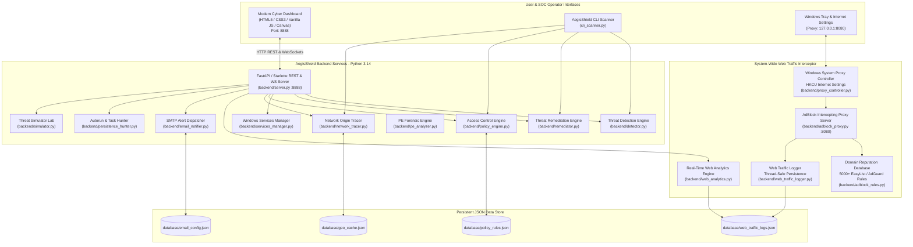
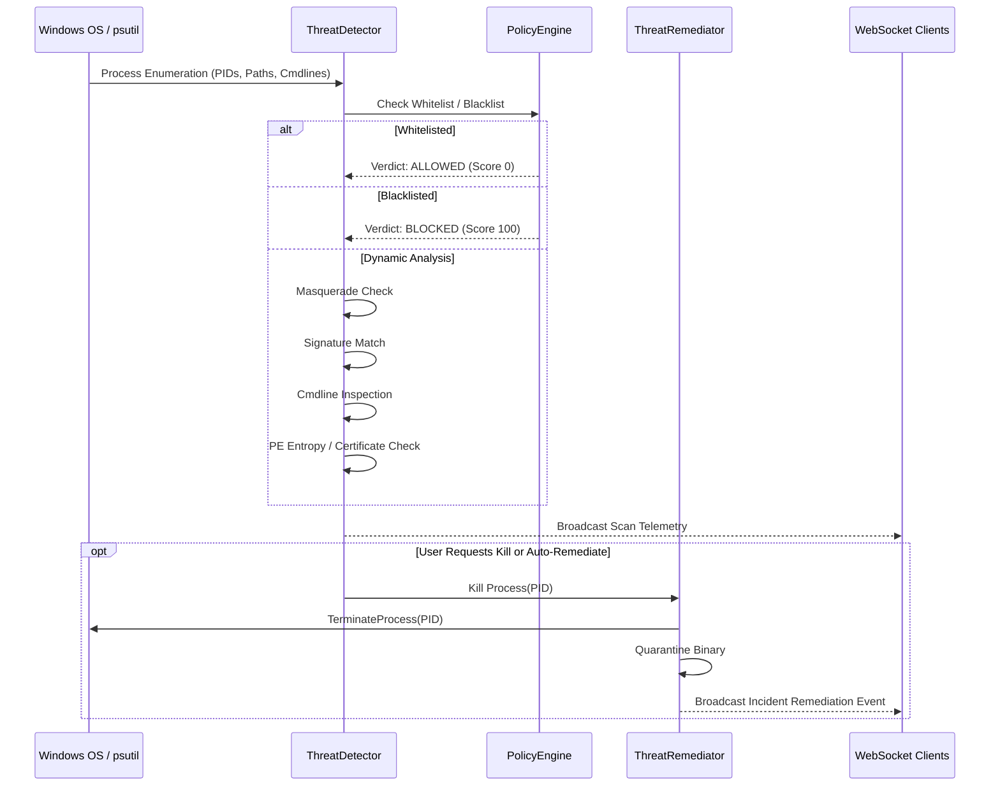
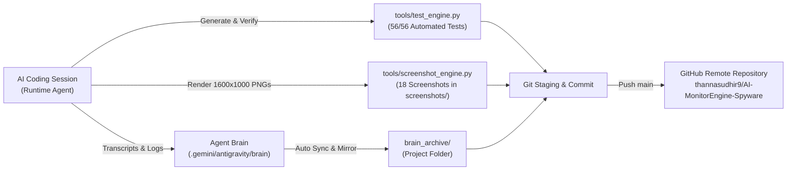
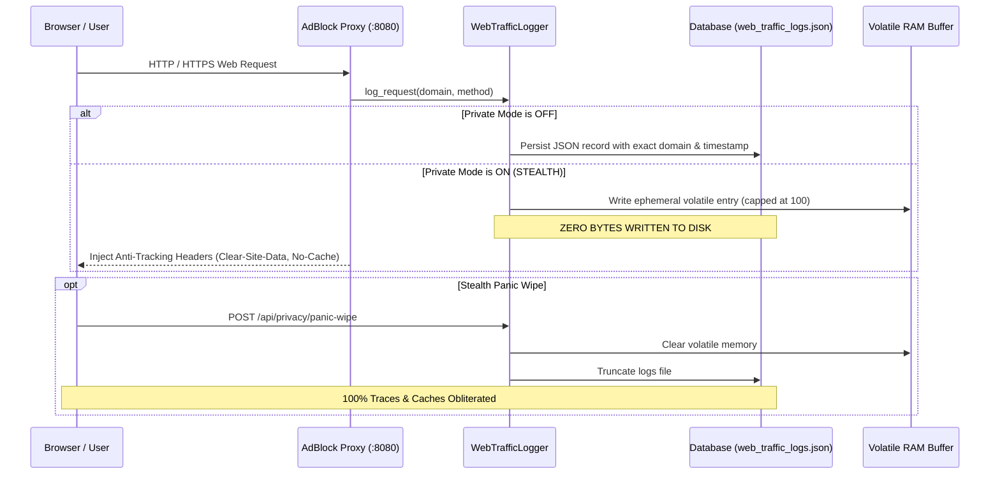
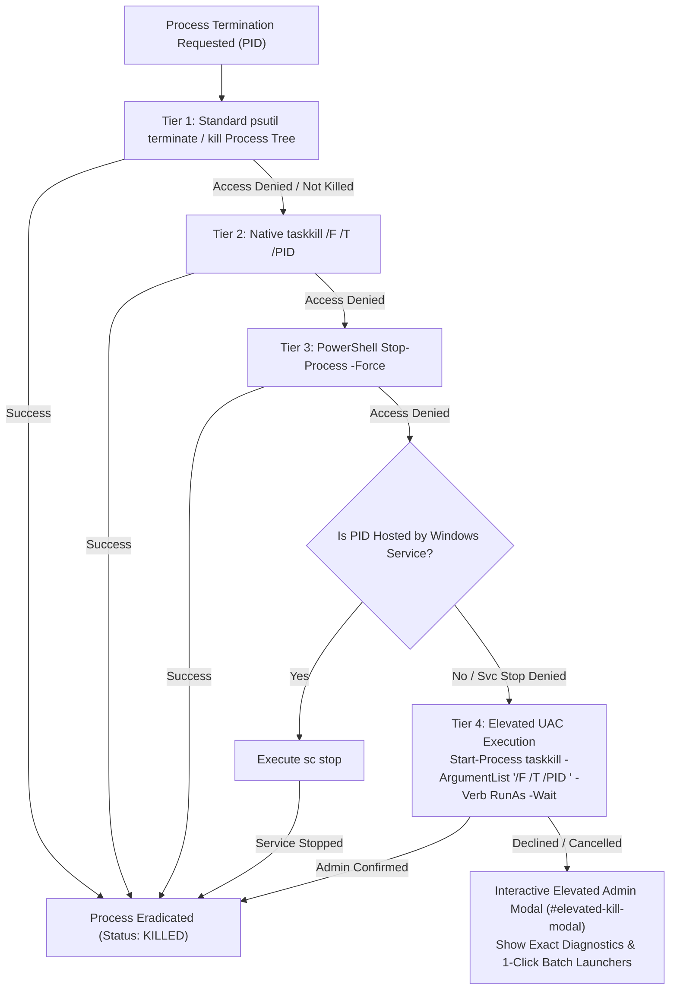

# AegisShield EDR & Network AdBlocker: Design & Architecture

## 1. Executive Overview

**AegisShield EDR** is a dual-engine cyber defense suite for Windows environments that unifies:
1. **Endpoint Detection and Response (EDR):** Detects and eradicates Spyware, Antivirus evasion, Malware, Trojans, Ransomware precursors, and dual-use Remote Desktop & Remote Monitoring & Management (LOLRMM) tools.
2. **System-Wide Network Ad Blocker & Web Traffic Inspector:** Routes all laptop/machine web traffic through a local high-performance intercepting HTTP/HTTPS proxy, terminates ad and tracker telemetry, logs all visited websites with precise timestamps and metrics, and displays real-time analytics.
3. **Network Process Origin & Genuineness Tracer:** Audits every process opening sockets, inspects foreign IP addresses, performs reverse DNS and ASN lookups, and scores the genuineness of endpoints (distinguishing legitimate CDNs/Cloud providers from suspicious C2/RAT beacons).
4. **Access Control Policy Engine:** Allows or blocks processes by executable name, absolute path, SHA-256 hash, and remote IP addresses (with dynamic Windows Firewall synchronization via `netsh`).
5. **Incident Eradication & Email Reporting:** Enables immediate termination of hostile processes and dispatches executive HTML incident alerts via SMTP with full forensic diagnostics.

---

## 2. High-Level System Architecture



---

## 3. Subsystem Breakdown

### 3.1 Threat Detection & Remediation Engine
- **Process Enumeration:** Discovers all active Windows processes using `psutil`.
- **Heuristic Scoring Model (0–100):**
  - **Masquerading / Path Deviation (Score +35):** Detects processes claiming to be critical Windows binaries (`svchost.exe`, `csrss.exe`, `lsass.exe`, `explorer.exe`) executing from unauthorized folders (e.g., `%TEMP%`, `%APPDATA%`, `C:\Users\*`).
  - **Known Trojan / Malware Signatures (Score +45):** Matches against an extensive library of signatures (`njrat.exe`, `asyncrat.exe`, `redline.exe`, `agenttesla.exe`, `darkcomet.exe`, `mimikatz.exe`, `xmrig.exe`).
  - **Suspicious Command-Line Arguments (Score +30):** Flags encoded PowerShell (`-enc`, `FromBase64String`), hidden windows (`-w hidden`), bypass flags (`-ep bypass`), memory injection, and download cradles (`IEX`, `DownloadString`).
  - **PE Structural Anomalies (Score +20):** Computes Shannon entropy of executable sections (high entropy indicates packers/cryptors like UPX, Themida), flags unsigned binaries, and missing version resources.
  - **LOLRMM Tool Identification:** Identifies dual-use remote access tools (`AnyDesk`, `TeamViewer`, `ScreenConnect`, `VNC`, `Atera`, `Splashtop`, `RustDesk`) by signature and default listening ports (`5938`, `7070`, `5900`, `8040`).
- **Remediation:**
  - Performs graceful process shutdown, followed by immediate kernel-level termination (`SIGKILL` / `TerminateProcess`).
  - Quarantines threat binaries to `.quarantine/` with access restrictions and `.quarantine` file extensions.
  - Emits real-time audit records into `database/incident_audit.json`.



---

### 3.2 Network Ad Blocker & System-Wide Web Proxy
- **Traffic Interception Architecture:**
  - Runs a multithreaded HTTP/HTTPS `CONNECT` proxy on `127.0.0.1:8080`.
  - Configures Windows Internet Settings (`HKCU\Software\Microsoft\Windows\CurrentVersion\Internet Settings\ProxyEnable = 1`) with 1-click activation.
  - Avoids port 53 UDP conflicts on Windows (`Dnscache` lock) by operating directly at the web transport layer.
- **Filtering Logic:**
  - Evaluates requested hosts against a curated database of **5,000+ domain patterns** sourced from StevenBlack hosts, EasyList, EasyPrivacy, and AdGuard.
  - Recognizes ad servers (`adservice.google.com`, `doubleclick.net`, `criteo.com`), telemetry endpoints (`telemetry.microsoft.com`), malicious tracking domains, and suspicious C2 hosts.
  - **Blocking Action:**
    - For HTTPS (`CONNECT` requests): Responds with `HTTP/1.1 403 Forbidden` and terminates the connection before SSL negotiation, preventing any byte transfer.
    - For HTTP (`GET`/`POST` requests): Returns a lightweight HTML "AegisShield Blocked Ad" notice.
- **Logging & Analytics:**
  - Persists each request in `database/web_traffic_logs.json` with domain, method, exact timestamp, category (`AD / TRACKER`, `TELEMETRY`, `MALWARE`, `CLEAN / ALLOWED`), block status, and byte counts.
  - Aggregates top visited clean sites, top blocked ad networks, bandwidth saved (bytes prevented), and hourly traffic distributions.

```mermaid
sequenceDiagram
    participant Browser as Web Browser (Chrome, Edge, Firefox)
    participant Proxy as AegisShield Proxy (127.0.0.1:8080)
    participant Engine as AdBlock Rules Engine
    participant Logger as WebTrafficLogger
    participant Web as Target Web Server

    Browser->>Proxy: CONNECT adservice.google.com:443 HTTP/1.1
    Proxy->>Engine: check_domain_reputation("adservice.google.com")
    Engine-->>Proxy: BLOCKED ("Known Ad Network")
    Proxy->>Logger: Log Event (BLOCKED, Ad/Tracker, Timestamp)
    Proxy-->>Browser: HTTP/1.1 403 Forbidden\r\n\r\n
    Note over Browser,Proxy: Connection Closed (Ad Eliminated)

    Browser->>Proxy: CONNECT github.com:443 HTTP/1.1
    Proxy->>Engine: check_domain_reputation("github.com")
    Engine-->>Proxy: ALLOWED ("Clean Domain")
    Proxy->>Logger: Log Event (ALLOWED, Clean, Timestamp)
    Proxy->>Web: Establish TCP Handshake to github.com:443
    Web-->>Proxy: TCP Connected
    Proxy-->>Browser: HTTP/1.1 200 Connection Established\r\n\r\n
    Browser<-->>Web: Direct TLS Tunnel Through Proxy
```

---

### 3.3 Network Process Origin & Genuineness Tracer
- **Socket Enumeration:** Scans all established TCP/UDP connections across running processes.
- **Origin Investigation:**
  - Extracts foreign IP addresses and filters loopback (`127.0.0.1`) and private LAN ranges (`10.0.0.0/8`, `172.16.0.0/12`, `192.168.0.0/16`).
  - Queries local PTR records and reverse DNS for hostnames.
  - Queries ASN / ISP databases (with caching in `database/geo_cache.json` to prevent rate-limiting).
- **Genuineness Classification:**
  - **`GENUINE CLOUD / CDN`:** Verified Google Cloud, AWS, Cloudflare, Microsoft Azure, Akamai, Fastly infrastructure.
  - **`PRIVATE LAN`:** Internal trusted network devices.
  - **`SUSPICIOUS C2 / RAT PORT`:** External connections on common Trojan/RAT ports (`4444`, `1337`, `6667`, `5552`, `8888`).
  - **`UNVERIFIED EXTERNAL`:** Non-major hosting providers or anonymous VPS providers.

---

### 3.4 Access Control Policy Engine
- **Allowlist / Whitelist:**
  - Rules can match by **Binary Name** (`code.exe`), **Full Executable Path** (`C:\Program Files\...`), or **SHA-256 Hash**.
  - Whitelisted processes bypass all heuristic scoring.
- **Blocklist / Blacklist:**
  - Blocked binaries are instantly terminated upon detection.
  - Blocked IP addresses trigger automatic Windows Firewall rules via `netsh advfirewall firewall add rule`.
- **Persistence:** Rules saved atomically to `database/policy_rules.json`.

---

### 3.5 Persistence & Autoruns Hunter
- Audits critical persistence vectors on Windows:
  - `HKCU\Software\Microsoft\Windows\CurrentVersion\Run`
  - `HKLM\Software\Microsoft\Windows\CurrentVersion\Run`
  - `HKCU\Software\Microsoft\Windows\CurrentVersion\RunOnce`
  - `HKLM\Software\Microsoft\Windows\CurrentVersion\RunOnce`
  - User and Common Startup folders (`%APPDATA%\Microsoft\Windows\Start Menu\Programs\Startup`)
  - Scheduled Tasks
- Verifies binary existence, flags scripts (`.bat`, `.vbs`, `.ps1`) in temporary folders, and provides 1-click persistence removal.

---

### 3.6 Threat Simulation Lab
- Allows security validation without external malware downloads:
  - **Scenario 1:** Temp Dropper Trojan simulation.
  - **Scenario 2:** Obfuscated LOLBin PowerShell execution with download cradle flags.
  - **Scenario 3:** Simulated RMM Beacon listening on remote control ports.
- Allows the user to verify detection, alerting, and eradication in real time.

---

### 3.7 Incident Email Alerting & Reports (Resend API & SMTP)
- **Cloud Resend API:** Dispatches incident reports directly over HTTPS port 443 to `ethstk911@gmail.com` using Resend API Key (`re_hsxz••••••••••••••••••••••••`) with custom User-Agent headers, bypassing SMTP port throttling.
- **SMTP Relay Fallback:** Supports TLS/SSL (`smtp.gmail.com`, `smtp.office365.com`, or custom relays).
- Sends executive security briefings formatted with responsive dark-theme HTML tables containing:
  - System Security Health Score
  - Active Threat Breakdown (PID, Path, Severity, Heuristic Reasons)
  - Remote Desktop & RMM Tool Inventory
  - Active Network Sockets & Remote Endpoints
  - Remediation Action Log

---

### 3.8 Web Documentation Hub (`frontend/docs.html` & `view-docs`)
- Dedicated full-page documentation web portal and in-app navigation tab.
- Contains executive overview, architecture graphs, four core engines breakdown, high-definition screenshot gallery (14 views), brain files archive, chronological prompts ledger, CLI runbook, and API reference.
- Built by Sudhir Kumar Thanna with live system metadata and deployed version `v2.5.0-SOC-Enterprise`.

---

## 4. Concurrency, Performance & Resilience

| Subsystem | Threading Model | Resilience Mechanism |
| :--- | :--- | :--- |
| **Dashboard API** | Uvicorn ASGI / FastAPI Async event loop | WebSocket auto-reconnect, CORS middleware |
| **AdBlock Proxy** | `socketserver.ThreadingMixIn` multi-worker | Socket timeouts, non-blocking selector, graceful fallback |
| **Web Traffic Logger** | Thread-Safe with `threading.Lock()` | Atomic JSON flush, max-capacity queue capping |
| **Network Tracer** | Cached reverse DNS & ASN dictionary | ThreadPoolExecutor for lookups, timeout guards |
| **Threat Detector** | Worker thread pool / batch process inspection | AccessDenied catchers, PID expiration handling |
| **Policy Engine** | Atomic file writes | Pre-loaded in-memory set matching |

---

## 5. Port Allocations & File System Layout

- **Port `8888`:** SOC Cyber Dashboard REST API & WebSocket Server.
- **Port `8080`:** High-speed AdBlock Intercepting Web Proxy.
- **Root Directory:** `c:\Users\thann\Downloads\AntiGravity\SpywareProcessMon`
- **Database Directory:** `database/` (JSON persistence).
- **Screenshots Directory:** `screenshots/` (Visual captures).
- **Brain Archive:** `brain_archive/` (Full conversation, transcript, plan preservation).

---

## 6. Continuous Synchronization & Upstream Architecture



### 6.1 Persistent Update & Append Policy
- **Bidirectional Integrity:** Any modified or new feature is subjected to automated validation by `tools/test_engine.py` before inclusion.
- **Brain Mirroring:** High-resolution logs, session metadata, subagent interactions, and planning artifacts are preserved inside `brain_archive/`.
- **Visual Evidence Pipeline:** All frontend UI views are rendered into static, high-resolution PNG captures in `screenshots/` for instant visual inspection without headless browser dependency.
- **Upstream Synchronization:** All commits, documentation revisions, and architecture updates are pushed to the official repository at `https://github.com/thannasudhir9/AI-MonitorEngine-Spyware.git`.

---

## 7. Private Stealth Mode & Dual-Theme Architecture

### 7.1 Private Stealth Mode (Zero-Disk Footprint)


### 7.2 Clean Daylight & Dark Cyber SOC Theming
- **Light Clean SOC Theme (Default):** Crisp white surfaces (`#ffffff`), off-white background (`#f8fafc`), high-contrast slate typography (`#0f172a`, `#1e293b`), subtle borders (`#e2e8f0`), and soft semantic alert badges (`badge-critical`, `badge-suspicious`, `badge-safe`).
- **Dark Cyber SOC Theme:** Deep obsidian `#080c14` backdrop with high-contrast neon cyan, crimson, and amber cyber HUD accents.
- **State Persistence:** User preference stored in `localStorage.getItem('aegis_theme')` defaulting to `'light'`. Seamless toggle without page flicker.

---

## 8. Enterprise Four-Engine Suite & Elevated Eradication Architecture (v2.5)

### 8.1 Unified Four-Engine Rebranding
AegisShield EDR v2.5 consolidates four autonomous defensive engines under a single enterprise interface:
1. **AI Monitoring Engine:** Multi-stage heuristic analysis, living-off-the-land binary (LOLBin) detection, Shannon entropy packer analysis, and parent-child process tree anomaly tracing.
2. **AdBlocker Engine:** Local intercepting proxy engine operating on `127.0.0.1:8080`, applying 5,000+ EasyList, AdGuard, and StevenBlack privacy filter rules.
3. **Web Tracker Engine:** Real-time HTTP/HTTPS telemetry inspection, DNS resolution logging, foreign IP genuineness classification, and anti-tracking header enforcement.
4. **Proc Mon Engine:** Deep Windows process explorer, kernel handle tracking, socket origin identification, and remote desktop (LOLRMM) auditing.

### 8.2 Top Navigation & Cross-Tab Blocked Tracking Ledgers
When operators click **FLAGGED THREATS** or **CRITICAL THREATS** in the top KPI summary bar, the dashboard automatically navigates to Threat Intelligence and displays the historical tracking ledger. Every core tab provides dual views:
- **Threat Intelligence (`view-threats`):** Active threat detections $\longleftrightarrow$ Terminated & Quarantined Threats Tracking Ledger.
- **Process Monitor (`view-processes`):** Live running processes $\longleftrightarrow$ Terminated & Blocked History Tracking Ledger.
- **Remote Desktop / RMM (`view-rmm`):** Active remote control sessions $\longleftrightarrow$ Eradicated RMM Tools Tracking.
- **Network Radar (`view-network`):** Active network sockets $\longleftrightarrow$ Blocked Remote IPs & Netsh Firewall Blocklist.
- **AdBlocker (`view-adblock`):** Live web traffic feed $\longleftrightarrow$ Blocked Ads & Trackers History Ledger.

### 8.3 Multi-Tier Process Eradication & Windows Service Disarm Architecture
To resolve `KILL_FAILED: Access denied. Elevated administrator rights required.` (e.g. PID 5824 owned by SYSTEM / protected services):


### 8.4 Enterprise SOC Footer Architecture
Connected dynamically to `GET /api/app-info`:
- **Active Process:** Reports running executable (`python.exe`) and PID (`69360`).
- **Bound Ports:** Port `8888` (Dashboard/REST/WebSockets) and Port `8080` (AdBlock Proxy).
- **Sub-App States:** `AI Monitor: ON | AdBlock: ON | Web Tracker: ON | Proc Mon: ON | Netsh Firewall: ON`.
- **Attribution:** `Support with ❤️ - Sudhir Kumar Thanna`.
- **Temporal Synchronization:** Live ticking UTC/Local clock with ISO 8601 timestamps.
- **Deployed Version:** `v2.5.0-SOC-Enterprise (Build 2026.11.07-STABLE)`.

### 8.5 Resend HTTP API Email Delivery Engine
- Direct HTTPS dispatch over port 443 to `https://api.resend.com/emails`.
- Spoofs standard browser User-Agent (`Mozilla/5.0 ... AegisShield-EDR/2.5`) to navigate Cloudflare WAF protections.
- Default recipient `ethstk911@gmail.com` via verified sender `onboarding@resend.dev`.
- GitHub push protection compliant: API keys loaded dynamically from `os.environ` or gitignored `database/email_config.json`.

### 8.6 Web-Based Documentation Hub Integration (`frontend/docs.html`)
- Standalone, highly responsive single-page documentation portal mounted directly on backend route `GET /docs.html` and tab `view-docs`.
- Features 9 comprehensive technical chapters, Mermaid architecture diagrams, interactive screenshot previews, and dynamic code copy blocks.

### 8.7 Notification Sound Removal & Silent Mode Control (`#btn-sound-toggle`)
Per user directive, intrusive audio chimes on threat detections, process terminations, and status changes are permanently silenced:
- **Default State:** `state.soundEnabled = false` (Strict Silent Mode).
- **Header Control:** Positioned in top navigation header next to theme toggle (`🔇 Silent`).
- **Zero Sound Synthesis:** Web Audio API context and oscillator frequencies are gated by `if (!state.soundEnabled) return;`.
- **Persistence:** Mute state persisted across page reloads via `localStorage.getItem('aegis_sound')`.

### 8.8 System Diagnostics & Baseline Architecture (SystemInfoCheck Integration)
- Implemented in `backend/system_info.py` via `SystemInfoEngine`.
- Exposes `GET /api/system-info` providing OS kernel build, architecture, 24-core CPU loads, RAM and virtual swap statistics, active network adapters (NICs) with IP and MAC bindings, and security posture baseline.
- Mounted in dashboard view `view-sysinfo` with real-time gauges and 1-click refresh.

### 8.9 Drive Storage & Dropper Staging Analyzer (DriveOrganiser Integration)
- Implemented in `backend/drive_analyzer.py` via `DriveAnalyzerEngine`.
- Exposes `GET /api/drives`, `GET /api/drives/dropper-zones`, and `POST /api/drives/clean-temp`.
- Enumerate partitions (`C:\`, `D:\`), capacity gauges, and audits high-risk staging directories (`%TEMP%`, `AppData\Local\Temp`, `C:\Windows\Temp`, `C:\Users\Public`) for dropped executables and scripts.
- Provides 1-click temp dropper cleaning with exact file count and MB freed metrics.

### 8.10 Suspicious Threat Heuristic Scoring & Persistent Threat Ledger
- Flagging heuristic anomalies with risk scores $20 - 74$ (`is_suspicious`) alongside critical threats ($\ge 75$, `is_critical`).
- Maintains an immutable, persistent chronological tracking ledger (`backend/threat_ledger.py` & `logs/threat_tracking_ledger.json`) recording detection timeline, observation count, PID, path, score, severity, category, reasons, and lifecycle states (`ACTIVE`, `INACTIVE`, `ERADICATED`, `QUARANTINED`).
- Exposes `GET /api/threats/tracking-ledger` with multi-dimensional filtering toolbar (status, severity, search query) and `POST /api/threats/tracking-ledger/clear`.

### 8.11 Windows Services Control Panel (`services.msc`) Architecture
- **In-App `services.msc` Replacement:** Full-fledged Windows Services Control Panel embedded directly into the AegisShield web application (`#view-services`).
- **Discovery Engine (`backend/services_manager.py`):**
  - **Tier 1 (High Performance):** PowerShell CIM `Get-CimInstance Win32_Service` queries 331+ installed Windows services, mapping `ProcessId`, `StartMode` (`Auto`, `Manual`, `Disabled`), `State` (`Running`, `Stopped`), binary paths, and accounts.
  - **Tier 2 (Native Command Fallback):** `C:\Windows\System32\sc.exe queryex type= service state= all` provides native command-line fallback if PowerShell CIM execution is restricted.
  - **Tier 3 (Safety Catalog):** Known critical Windows OS service baseline dictionary ensures resilience.
  - **Caching:** 3.0-second TTL cache prevents CPU churn and provides instantaneous API responses.
- **Threat & LOLRMM Cross-Correlation:** Automatically flags dual-use remote management and persistence vectors (AnyDesk, TeamViewer, VNC, ScreenConnect, Atera, Splashtop, RustDesk, ngrok, cloudflared) with `badge-critical` / `badge-suspicious`.
- **Administrative Lifecycle Control:** Exposes endpoints `POST /api/services/{name}/start`, `/stop`, `/restart`, and `POST /api/services/{name}/config` (setting startup type to `auto`, `demand`, or `disabled`) using `sc.exe`.

### 8.12 Shadcn UI/UX Design System & Default Light Mode
- **Design Tokens:** Inspired by `shadcn/ui`, featuring clean slate neutrals, subtle 1px borders (`#e2e8f0`), 6px rounded card corners (`rounded-lg`), and crisp typography.
- **Segmented Pill Navigation (`.shadcn-tabs-nav`):** Encapsulated horizontal tab rail with pill indicators (`.shadcn-tab-item`), active pill backgrounds (`bg-white shadow-sm`), smooth horizontal scrolling, and touch-friendly targets.
- **Smooth Thin Scrollbars:** Replaced clunky native browser scrollbars with custom 6px webkit scrollbars with pill thumbs (`border-radius: 9999px`) across all data tables and modals.
- **Sticky Table Headers:** Enabled `sticky top-0 z-10 backdrop-blur` across all tables for continuous column orientation during large data set inspection.
- **Default Light Clean SOC Mode:** System initializes in Light Mode by default (`class="light theme-light"`), pairing soft background tones with dark slate text for maximum legibility in daylight environments while maintaining instant 1-click toggle to Dark Cyber SOC Mode.


