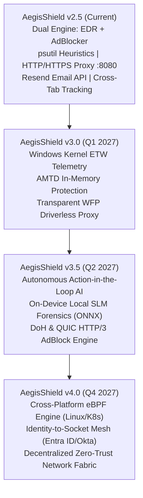
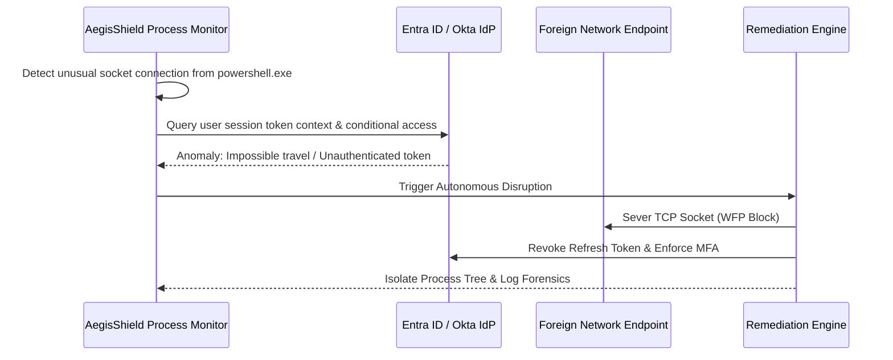

# AegisShield Enterprise: Future Scope & Technical Roadmap (2026–2027)

**Product Suite:** AI Monitoring Engine • AdBlocker Engine • Web Tracker • Proc Mon Engine  
**Lead Security Architect:** Sudhir Kumar Thanna  
**Release Horizon:** Version 3.0.0 through Version 4.5.0  
**Last Updated:** 2026-11-07  

---

## 1. Executive Vision & The 2026–2027 Threat Landscape

As cyber adversaries evolve past traditional disk-resident malware into fileless in-memory execution, token impersonation, Living-off-the-Land (LOLBAS) attacks, and covert encrypted C2 channels (DNS-over-HTTPS, QUIC, WebSocket steganography), endpoint defense must transition from reactive human triage to **Autonomous Action-in-the-Loop Disruption**.

The future trajectory of **AegisShield EDR** integrates kernel-native observability, proactive memory defense, local edge AI reasoning, and unified network/adblocking privacy into a hardened enterprise cyber shield.



---

## 2. Six Core Architectural Pillars

### Pillar 1: High-Fidelity Windows Kernel Telemetry (ETW / Microsoft-Sanctioned Kernel APIs)
- **Problem Statement:** Standard user-mode polling via `psutil` or snapshot intervals risks missing ephemeral, sub-second execution chains (e.g. self-deleting batch droppers or in-memory reflection).
- **Architecture:** Implement native event consumers using **Event Tracing for Windows (ETW)**:
  - `Microsoft-Windows-Kernel-Process`: Real-time notification of every `ProcessCreate`, `ProcessTerminate`, and parent-child linkage.
  - `Microsoft-Windows-Kernel-Network`: Kernel-level TCP/UDP socket bind, connect, and disconnect hooks.
  - `Microsoft-Windows-Kernel-File`: Instant detection of mass file renaming or encryption patterns (ransomware precursors).
- **Benefit:** Eliminates polling CPU overhead while ensuring **100% crash immunity** (avoiding unverified kernel-mode drivers that cause Blue Screens of Death).

### Pillar 2: Autonomous Action-in-the-Loop Attack Disruption
- **Sub-Second Containment:** Move beyond alert notifications to automated machine-speed containment:
  - **Dynamic Host Isolation:** Instantly sever all inbound/outbound external network traffic via Windows Filtering Platform (WFP), preserving strictly loopback (`127.0.0.1`) for SOC analysis.
  - **Micro-Token Suspension:** Freeze suspicious process threads and revoke access tokens before credential dumping (`lsass.exe`) can complete.
  - **Automated VSS Preservation:** Trigger immediate Volume Shadow Copy (VSS) snapshots upon detecting initial ransomware behavioral anomalies.

### Pillar 3: Automated Moving Target Defense (AMTD) & In-Memory Shielding
- **Memory Address Space Disruption:** Dynamically randomize virtual memory base addresses and function pointers for protected applications, neutralizing Return-Oriented Programming (ROP) and buffer overflow exploits.
- **AMSI & API Integrity Guardian:** Continuously verify the in-memory integrity of `amsi.dll` and `ntdll.dll` hooks to detect and reverse memory patching techniques utilized by loaders.

### Pillar 4: Next-Gen Transparent Network & AdBlock Engine (QUIC, HTTP/3 & DoH)
- **DNS-over-HTTPS (DoH) / DNS-over-TLS (DoT) Sinkhole:** Provide an internal encrypted recursive DNS resolver that terminates DoH/DoT queries, blocking tracker telemetry and identifying malicious encrypted C2 beacons.
- **QUIC / HTTP/3 UDP Interception:** Extend interception capabilities to UDP port 443 (Google QUIC, HTTP/3) for seamless modern web tracking eradication.
- **WFP Transparent Socket Redirector:** Driverless redirection of outbound port 80/443 traffic directly into the local proxy engine without manual proxy configuration.

### Pillar 5: On-Device Edge AI / Local SLM Threat Hunting
- **Offline Intelligence:** Deploy a localized, quantized Small Language Model (SLM e.g. Gemma 2B, Phi-3 Mini) powered by ONNX Runtime with DirectML hardware acceleration.
- **Zero-Cloud Leakage:** Complete forensic analysis of living-off-the-land command lines and registry modifications executed entirely offline on the client endpoint.
- **Natural Language Incident Narratives:** Automatically compile executive incident summaries and root-cause timelines without sending proprietary telemetry off-premises.

### Pillar 6: Cross-Platform eBPF Observability (Linux, Cloud & Containers)
- **Extended Berkeley Packet Filter (eBPF):** Deploy a unified sensor architecture for Linux servers, Docker containers, and Kubernetes pods.
- **Safe Kernel Observability:** Monitor system calls (`execve`, `connect`, `openat`) in a sandboxed, verified kernel runtime with zero stability compromises.

---

## 3. Comprehensive Feature Roadmap

```
2026 Q4 (v2.5 Current)   ───> 2027 Q1 (v3.0 Hardening)  ───> 2027 Q2 (v3.5 AI & Privacy) ───> 2027 Q4 (v4.0 Enterprise)
• 4 Autonomous Engines        • Windows Kernel ETW Pipeline   • Local SLM Agent (ONNX)       • Cross-Platform eBPF
• Multi-Tier UAC Eradicator   • AMTD In-Memory Shielding      • HTTP/3 & QUIC AdBlocker      • Zero-Trust Identity Mesh
• Resend API & SMTP Alerts    • Automated Host Isolation      • DoH/DoT Encrypted Resolver   • Distributed SIEM Exporter
• Cross-Tab Tracking Ledgers  • 1-Click Process Sandboxing    • Ransomware VSS Rollback      • Mobile Companion App
```

| Phase | Target Version | Key Deliverables & Innovations | Target Delivery |
| :--- | :--- | :--- | :--- |
| **Phase 1** | **v3.0.0** | **Kernel ETW Telemetry & Automated Containment**<br>• Real-time Event Tracing for Windows process/socket capture<br>• Windows Filtering Platform (WFP) 1-click host network isolation<br>• Memory-resident AMSI patch restoration<br>• Automated Windows Service dependency disarm | **Q1 2027** |
| **Phase 2** | **v3.5.0** | **On-Device Edge AI & Next-Gen AdBlocker**<br>• Local quantized SLM threat analyzer (100% offline)<br>• HTTP/3 and QUIC UDP port 443 interception<br>• Encrypted DoH / DoT DNS sinkhole server<br>• Automated Moving Target Defense (AMTD) address shifting | **Q2 2027** |
| **Phase 3** | **v4.0.0** | **Cross-Platform Enterprise Cloud Mesh**<br>• eBPF Linux & Kubernetes container security sensors<br>• Identity-to-socket correlation with Entra ID and Okta<br>• MITRE ATT&CK v16 real-time behavioral graph visualization<br>• OpenTelemetry & Syslog SIEM forwarding (Splunk, Elastic, Sentinel) | **Q4 2027** |

---

## 4. MITRE ATT&CK Matrix v16 Coverage Targets

AegisShield's detection engineering roadmap systematically maps heuristics against MITRE ATT&CK enterprise tactics:

| Tactic | Technique ID | Description | AegisShield Target Implementation |
| :--- | :--- | :--- | :--- |
| **Execution** | `T1059.001` | PowerShell Living-off-the-Land | In-memory AST syntax analysis, encoded command unmasking, and AMSI hook integrity validation. |
| **Persistence** | `T1547.001` | Registry Run Keys / Startup Folder | Real-time registry handle monitoring with instant rollback and atomic snapshot diffing. |
| **Defense Evasion**| `T1036.005` | Masquerading System Binaries | Deep path normalization against authenticated Windows binaries; Shannon entropy evaluation. |
| **Credential Access**| `T1003.001` | LSASS Memory Dumping | Instant thread suspension on processes opening `PROCESS_VM_READ` handles to `lsass.exe`. |
| **Discovery** | `T1046` | Network Service Scanning | Socket origin tracer flags rapid port sweep patterns and alerts operator. |
| **Lateral Movement**| `T1021.001` | Remote Desktop (LOLRMM) | Continuous audit of AnyDesk, TeamViewer, RustDesk, UltraVNC with 1-click service disarm. |
| **C2 Communication**| `T1071.004` | DNS Encrypted Tunneling | DoH/DoT privacy proxy intercepts encrypted queries and evaluates high-entropy domain names. |
| **Impact** | `T1486` | Data Encrypted for Impact | Rapid mass file-rename heuristic triggers automated process tree SIGKILL and VSS snapshot. |

---

## 5. Enterprise Identity & Zero-Trust Integration

Modern cyber adversaries rarely "hack" endpoints with novel zero-days; they log in using legitimate stolen credentials. The v4.0 architecture bridges the gap between identity and endpoint processes:



---

## 6. Industry Research & References

1. **Autonomous Action-in-the-Loop Cyber Defense:** Palo Alto Networks / Unit 42 2026 Security Architecture Review.
2. **Event Tracing for Windows (ETW) Best Practices:** Microsoft Security Response Center (MSRC) Kernel Observability Whitepaper.
3. **eBPF-Based Cloud Workload Protection:** Linux Foundation & Cilium Enterprise Security Architecture.
4. **Automated Moving Target Defense (AMTD):** Gartner Emerging Tech: Automated Moving Target Defense for Endpoint Protection.
5. **MITRE ATT&CK Enterprise Matrix:** Version 16.0 (Process Injection, Defense Evasion, and Remote Services).
